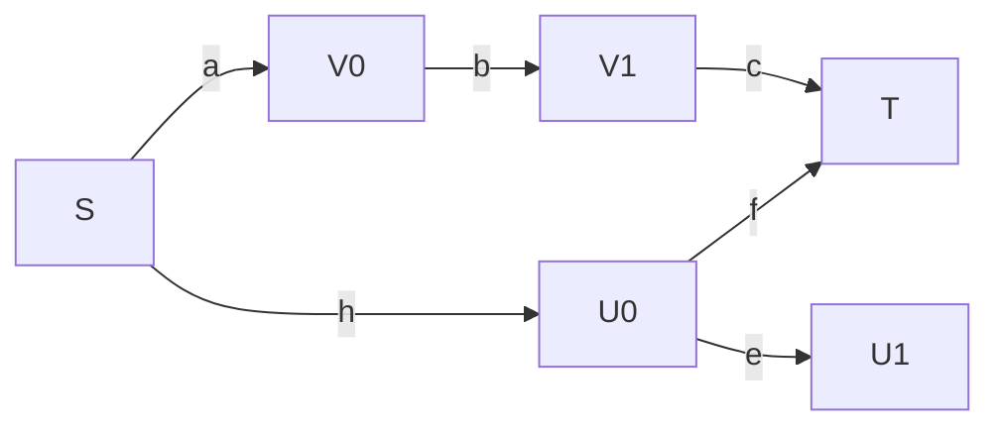

# Free higher categories with directed interchange in every dimension (third round)

*A self-contained problem. No background beyond standard higher category theory is assumed. Rounds 1 and 2, with their answers, are in `answered/`. Questions are in §4, smallest first.*

## 1. Setting

**Globular sets and composition.** Work with reflexive globular sets with source and target maps s, t, identities, and for k < n a partial composition ∗ₖ of n-cells along k-cells. Composition is written in **diagrammatic order** (u ∗ₖ v means "first u, then v"), and it is strictly associative and unital. The boundary formulas hold: for k < m and (m+1)-cells u, v,

```
s(u ∗ₖ v) = s(u) ∗ₖ s(v),     t(u ∗ₖ v) = t(u) ∗ₖ t(v).        (B)
```

For k < l < n and n-cells in interchange position put `L(a,b,c,d) := (a ∗ₗ b) ∗ₖ (c ∗ₗ d)` and `R(a,b,c,d) := (a ∗ₖ c) ∗ₗ (b ∗ₖ d)`. A strict ω-category requires L = R.

**The Gray case (directed interchange along 0-cells only).** In a category enriched in strict ω-categories with the lax Gray tensor product (Ara–Maltsiniotis, arXiv 1607.00668), for 2-cells α : f ⇒ f′ : x → y and β : g ⇒ g′ : y → z there is a 3-cell

```
χ_{α,β} : (f ◁ β) ∗₁ (α ▷ g′)  ⇛  (α ▷ g) ∗₁ (f′ ◁ β)
```

and nothing in the reverse direction. Composition along k-cells with k ≥ 1 is strict. For a finite globular pasting diagram Γ = ΣΘ₁ ∨ … ∨ ΣΘₙ, the free such structure has homs ν(λΘᵢ₊₁ ⊗ … ⊗ λΘⱼ). Here λ is Steiner's directed complex, ⊗ is Steiner's tensor with `∂(x ⊗ y) = ∂x ⊗ y + (−1)^{|x|} x ⊗ ∂y`, and ν is Steiner's functor to strict ω-categories (Steiner, HHA 2004). Each hom is generated by tuples of cells, and a cell is determined by the set of generators it uses.

**The aim** is the same for directed interchange along k-cells for **every** k, including inside homs.

## 2. What is already known (all proved)

**(K1) Raw higher interchangers are impossible.** If every pair of n-cells in interchange position had an (n+1)-cell L → R, then applying this to identities and using (B) forces L = R one dimension down. That contradicts directedness.

**(K2) A single comparison for each simultaneous variation is impossible.** The obvious repair of (K1) adds, for 3-cells A : a ⇛ a′, …, D : d ⇛ d′ in interchange position, a 4-cell between the parallel 3-cells

```
L(A,B,C,D) ∗₂ χ_{a′}     and     χ_a ∗₂ R(A,B,C,D).        (N)
```

This cannot be required for every instance. Take Γ = ΣD² ∨ ΣD², with two 3-cells A : α ⇛ α′ and B : β ⇛ β′ side by side along a 0-cell, and the instance (A, 1, 1, B). Its two sides map to the hom 2-cells

```
U = (v₀ ∘₀ u₁) ∘₁ c₁₁,     V = c₀₀ ∘₁ (u₀ ∘₀ v₁)
```

of ν(λD² ⊗ λD²), where `u_j = A ⊗ g_j`, `v_i = f_i ⊗ B` and `c_ij = α_i ⊗ β_j`. There is no 4-cell between U and V in either direction: the degree-3 chain would need a positive coefficient at u₀ (or at v₀), but every basis element of degree 3 has a non-positive coefficient there.

**(K3) The two variables have opposite naturality directions.** The degree-3 basis elements are `r_j = A ⊗ β_j` and `t_i = α_i ⊗ B`. Their differentials are

```
∂r_j = c_1j + u₁ − c_0j − u₀,     ∂t_i = c_i0 + v₁ − c_i1 − v₀.
```

So when only A varies, the Gray structure has a naturality 4-cell from the "χ first" side to the "variation first" side (V ⇛ U). When only B varies, it goes the other way (U ⇛ V). The simultaneous variation is the 5-cell A ⊗ B. It goes between two routes of 4-cells, `S → V → T` ⇛ `S → U → T`, where S and T are the composites through c₀₁ and c₁₀. In short, the higher structure is **tensor-shaped**: one Leibniz-signed naturality cell per variable, and higher cells between routes.

**(K4) Supports must use an expanded basis.** If every composite's support were the union of the supports of its parts, L and R would always have equal support. Then "support determines the cell" would force strict interchange.

**(K5) One finite basis forces finitely many cells.** If one finite set B admits injective support maps in every dimension, the structure has finitely many non-identity cells in total.

**(K6) No single directed complex presents the answer, and neither does a hom-wise family of them.** In ν(K), the two composites defining χ have the same chain table, so they are equal. A description must therefore be an iterated tower: objects, then homs presented again by objects and homs, and so on.

**(K7) The first uniform case through hom-dimension 3.** For Γ = ΣD² ∨ ΣD², directing interchange inside the hom 𝒦(x, z) adds exactly two generators of hom-dimension 3 beyond the 25 tensor generators. They are the interchangers χ₁ of (A⊗g, f′⊗B) and χ₂ of (f⊗B, A⊗g′), the only pairs of hom-2-cells composable along a hom-0-cell. Their two sides have different supports. Neither occurs in the boundary of A ⊗ B.

**(K8) The (K7) 3-skeleton cannot be extended by 4-generators alone (round 2, proved).** Write h_i^j = α_i ⊗ g_j, k_j^i = f_i ⊗ β_j, P_ij = k_j^0 h_i^1, Q_ij = h_i^0 k_j^1, so c_ij : P_ij ⇒ Q_ij. The tensor 3-generators are r_j : c_0j ; a_j^+ ⇛ a_j^- ; c_1j and t_i : b_i^- ; c_i1 ⇛ c_i0 ; b_i^+ (a_j^±, b_i^± the whiskered edge cells u_j, v_i), and the interchangers are χ₁ : b_0^+ ; a_1^+ ⇛ a_0^+ ; b_1^+ and χ₂ : a_0^- ; b_1^- ⇛ b_0^- ; a_1^-. The six composite hom-2-cells P₀₀ ⇒ Q₁₁ are S = b_0^- ; c_01 ; a_1^+, V₀ = c_00 ; b_0^+ ; a_1^+, V₁ = c_00 ; a_0^+ ; b_1^+, T = a_0^- ; c_10 ; b_1^+, U₀ = a_0^- ; b_1^- ; c_11 and U₁ = b_0^- ; a_1^- ; c_11. Whiskering gives t̄₀ : S ⇛ V₀, χ̄₁ : V₀ ⇛ V₁, r̄₀ : V₁ ⇛ T, r̄₁ : S ⇛ U₁, χ̄₂ = χ₂ ∗₁ 1_{c₁₁} : U₀ ⇛ U₁ and t̄₁ : U₀ ⇛ T. Since ∂(A⊗B) = t₁ − t₀ + r₁ − r₀, requirement 4 forces a 4-cell between the route t̄₀, χ̄₁, r̄₀ from S to T and a route from S to T using r̄₁ and t̄₁. In the free 3-skeleton with exactly the 25 tensor generators plus χ₁, χ₂ and no 2-equations, the first route exists, but the second would have to go S ⇛ U₁ and then U₁ ⇛ U₀ against χ̄₂: in the directed graph of these composites the only S → T path is t̄₀, χ̄₁, r̄₀. So no list of 4-generators recovers A ⊗ B. The naturality cells of χ₁, χ₂ are trivial here (the edge homs have no 3-generators).

The repair must change dimension-3 data: an extra 3-generator such as h : S ⇛ U₀ whose image under the Gray quotient is r̄₁, or a 2-equation such as U₀ = U₁. Inverting χ₂ would also work but breaks requirement 3.

**(K9) The orientation of χ₁, χ₂ in (K7) is forced by substitution (proved).** One might try to avoid (K8) by orienting every inner interchanger by the factor order of the enclosing tensor (always "Θ₂-cell first ⇛ Θ₁-cell first"), which keeps χ₁ and reverses χ₂. This fails requirement 5. The free object on Σ(D² ∨ D²) has, inside its hom, the interchanger of its two 2-cells A′ (left) and B′ (right), oriented as in the Gray case: "B′ first ⇛ A′ first". The assignment A′ ↦ f₀ ⊗ B and B′ ↦ A ⊗ g₁ (with the hom-0-cells and hom-1-cells sent to f₀⊗g₀, f₀⊗g₁, f₁⊗g₁ and to the matching edges) respects all boundaries, so substitution sends that interchanger to a 3-cell from "A ⊗ g₁ first" to "f₀ ⊗ B first", which is exactly χ₂ in its (K7) orientation. The pair χ₁ is forced the same way via A′ ↦ A ⊗ g₀, B′ ↦ f₁ ⊗ B. So χ₂ cannot be reversed: adding the reversed cell as well breaks requirement 3, which is the "inverting χ₂" option above. Inner interchangers are oriented by position (right cell first ⇛ left cell first), as at the outer level, and some repair of the kind in Q1 is needed.

**Literature.** No construction and no impossibility result is known.
- Closest: n-sesquicategories, which have no interchange at all (Araújo, arXiv 2202.09293 and 2210.07704; Forest–Mimram, arXiv 2211.16099 and *Rewriting in Gray categories*, MSCS 2022).
- Crans's teisi.
- Bourke–Lobbia, arXiv 2610.31448: their §4.2.6 lax 4-categories have non-invertible outer interchangers, but invertible interchange inside homs.
- Bourke–Gurski's cocategorical obstruction needs hypotheses not assumed here.

## 3. Requirements

A **tensor-shaped lax-interchange ω-category** has, for every k < l, elementary interchangers χ : L ⇛ R for (l+1)-cells with no reverse cell in free objects; one naturality cell per varying argument, oriented by the Leibniz sign; higher cells between routes of lower naturality cells; and coherence equations to be determined. The free objects F(Γ) must satisfy:
1. an explicit combinatorial description by generators with explicit boundaries;
2. two cells of the same dimension using the same generators, in the expanded basis, are equal;
3. every elementary interchanger exists and its reverse does not;
4. making all interchangers with k ≥ 1 identities gives the free Gray-enriched category, and making all interchangers identities gives the free strict ω-category;
5. closure under substitution of cells for generators.

## 4. Questions

**Q1 (the repaired 3-skeleton, smallest case).** For Γ = ΣD² ∨ ΣD², find the minimal hom-dimension-3 data to add to the 25 tensor generators and χ₁, χ₂ so that both boundary routes of A ⊗ B exist and requirements 2–4 still hold in dimension ≤ 3. Is a generator h : S ⇛ U₀ (or its mirror through χ₁) forced, and what is its image under the Gray quotient? Is it itself an interchanger of some pair of whiskered cells, i.e. is it part of a uniform rule ("interchange of a whiskered 2-cell with a 3-cell's boundary")? Note that a new 3-generator h survives the quotient of requirement 4 (it is not an interchanger), so it must either be classed as an interchanger-type cell that the quotient sends to r̄₁, or be accompanied by a 4-cell or equation relating it to r̄₁ and χ̄₂. Or is a 2-equation such as U₀ = U₁ the right repair? It equates two hom-2-cells whose unwhiskered parts a₀⁻ ; b₁⁻ and b₀⁻ ; a₁⁻ differ, which makes χ̄₂ an endo-3-cell of U₀: is that compatible with requirements 2 and 3?

**Q2 (dimension 4).** With the repaired 3-skeleton, give the 4-generators (the comparison for A ⊗ B and any naturality cells of the new 3-generators) and check requirements 2 and 4.

**Q3 (definition).** Is there a recursive "Gray tensor of towers" whose generators include the repairs of Q1 uniformly, giving F(Γ) with 1–5, up to some finite dimension N ≥ 5?

**Q4 (impossibility).** Can requirements 1–3 alone be shown inconsistent? (K1), (K2) and (K8) all use requirement 4 or (B).

## 5. What counts as a solution

Explicit generators for Q1 or Q2; a definition for Q3, even in finite dimension; an impossibility proof for Q4; or a reference to a published construction.

# Researcher Response

**The stipulated skeleton has a finite repair: add one hom-3 generator and one hom-3 equation.** The equation is essential for the exact Gray quotient, and the contextual support basis must be refined.

Write
\[
d=\bar r_1:S\longrightarrow U_1,
\qquad
e=\bar\chi_2:U_0\longrightarrow U_1.
\]
Adjoin
\[
\boxed{h:S\longrightarrow U_0}
\]
and impose
\[
\boxed{h *_2 e=d.} \tag{F}
\]
Then the lifted top generator has boundary
\[
\boxed{
W:
\bar t_0 *_2\bar\chi_1 *_2\bar r_0
\;\Longrightarrow\;
h *_2\bar t_1.
} \tag{W}
\]

Below I prove support injectivity, directedness, and the exact Gray quotient for this finite presentation. This answers Q1–Q2 at the level of the prescribed skeleton. Making the factorization (F) compatible with substitution into arbitrary diagrams remains the missing step for Q3.

## 1. The repaired hom-3 presentation

Abbreviate the six contextual hom-3 cells as follows.

| Symbol | Cell | Boundary |
|---|---|---|
| \(a\) | \(\bar t_0\) | \(S\to V_0\) |
| \(b\) | \(\bar\chi_1\) | \(V_0\to V_1\) |
| \(c\) | \(\bar r_0\) | \(V_1\to T\) |
| \(d\) | \(\bar r_1\) | \(S\to U_1\) |
| \(e\) | \(\bar\chi_2\) | \(U_0\to U_1\) |
| \(f\) | \(\bar t_1\) | \(U_0\to T\) |

In this section, concatenation means hom-3 composition \(*_2\).

The repaired presentation is
\[
\langle a,b,c,d,e,f,h\mid d=he\rangle.
\]
Eliminating \(d\) gives the free category on this graph:



Its nonidentity arrows are exactly
\[
\boxed{
a,\ b,\ c,\ h,\ e,\ f,\ ab,\ bc,\ abc,\ he,\ hf.
} \tag{1}
\]
In particular, its two \(S\to T\) arrows are
\[
abc,\qquad hf.
\]

The old cell \(d\) remains present, with normal form \(he\). No two old arrows are identified: the old nonidentity arrows were
\[
a,b,c,d,e,f,ab,bc,abc,
\]
and their images under \(d\mapsto he\) are distinct members of (1).

### Minimality

This is minimal **among repairs that retain the hom-2 skeleton** and obtain the exact Gray quotient by killing the existing inner interchangers.

With no new hom-3 generator, the only existing \(S\to T\) arrow is \(abc\). Equations among existing hom-3 cells cannot create another arrow.

For the repair using \(h\), a relation is also necessary. Without (F), killing \(e\) leaves two independent arrows
\[
q(h),q(d):S\longrightarrow U
\]
in the quotient. Equation (F) identifies precisely those arrows after \(e\) becomes an identity.

Thus one new hom-3 generator and one hom-3 equation suffice, and neither can be omitted from this repair.

However, **\(h\) itself is not forced**. Another repair is
\[
k:U_1\longrightarrow T,
\qquad
f=ek,
\]
with top boundary
\[
W_k:abc\Longrightarrow dk.
\]
Its Gray image satisfies \(q(k)=q(f)\). These are two choices of which existing contextual cell to factor through the directed interchanger.

## 2. Why the calculation extends beyond the six displayed 2-cells

The relevant hom-2 paths are paths in an oriented 3-cube. Its vertices are
\[
P_{ij},Q_{ij},
\]
and its twelve directed edges are
\[
a_j^\pm,\qquad b_i^\pm,\qquad c_{ij}.
\]

Use \(A,B,C\) for the three coordinate changes. The six maximal paths are
\[
\begin{array}{c|cccccc}
\text{Path}&S&V_0&V_1&T&U_0&U_1\\ \hline
\text{Word}&BCA&CBA&CAB&ACB&ABC&BAC.
\end{array}
\]

The six original hom-3 generators are the six square-face comparisons. Every proper interval of this cube varies at most two coordinates. Consequently, a proper interval has at most one nonidentity hom-3 arrow. All interactions between several face comparisons therefore occur in the maximal interval \(P_{00}\to Q_{11}\), and are exactly the graph used above.

There are no additional contexts in which the equation \(d=he\) must be reduced:

1. **Hom-2 whiskering:** its hom-1 boundary is \(P_{00}\to Q_{11}\), the initial-to-terminal interval of the cube. No nonidentity hom-2 path can be prefixed or suffixed.
2. **External whiskering:** its hom-0 boundary spans the entire external square. No nonidentity external hom-1 path extends it.
3. **Hom-3 composition:** \(S\) has no incoming nonidentity hom-3 arrow, and \(U_1\) has no outgoing one.

Moreover, two nonidentity square-face comparisons cannot occupy consecutive, disjoint lower-composition intervals: that would require at least four coordinate changes, whereas the cube has three.

Thus orienting (F) as
\[
d\longmapsto he
\]
gives a terminating reduction with no overlaps in this finite skeleton. The proper-interval arrows remain unchanged; the maximal-interval normal forms are exactly (1).

This uses the composition-of-whiskers presentation convention. Forest–Mimram’s Theorem 1.8.3 provides the corresponding normal-form formalism for free precategories; the additional reduction here is the explicitly checked contextual rule \(d\mapsto he\). [arxiv.org](https://arxiv.org/pdf/2109.05369?utm_source=chatgpt.com)

## 3. Support injectivity requires a refined contextual basis

The support cannot remain the old support function with an independent extra label \(h\). In particular, one cannot simultaneously declare

- \(d\) to be an independent contextual support atom;
- \(he\) to have support \(\{h,e\}\);
- \(d=he\);

and obtain a well-defined support function with those declarations.

The repair instead makes the contextual copy \(d\) composite.

### The basis

Retain the lower-dimensional contextual basis. In hom-dimension 3, use:

- the six square-face generators on proper intervals;
- the six maximal-context generators
  \[
  a,b,c,h,e,f.
  \]

The unwhiskered \(r_1\) remains a generator on its proper interval. Its particular whiskering
\[
d=b_0^-\triangleright r_1
\]
has normal form \(he\).

This distinction is essential: **a generator on one interval can be sent by whiskering to a composite on a larger interval**. No cancellation of \(b_0^-\) is used.

### Definition of support

Give each contextual basis generator its own graded label. Define support recursively:

\[
\operatorname{supp}(g)
=
\{\text{label of }g\}
\cup\operatorname{supp}(s g)
\cup\operatorname{supp}(t g)
\]
for a basis generator \(g\);

\[
\operatorname{supp}(g_1\cdots g_m)
=
\bigcup_{i=1}^{m}\operatorname{supp}(g_i)
\]
for a nonempty normal-form path; and
\[
\operatorname{supp}(1_x)=\operatorname{supp}(x).
\]

In particular,
\[
\operatorname{supp}(d)
=
\operatorname{supp}(he).
\]

These labels index generators and specified whiskering contexts. They do not index every composite cell.

### Proof of injectivity

At hom-dimension 2, a nonempty directed cube path is determined by its set of directed edges. A path in an acyclic graph cannot repeat a vertex, and the directed edges of a path determine their order. Identities are distinguished by their lower-dimensional supports.

At hom-dimension 3:

- a proper-interval nonidentity cell has its proper-face label;
- a maximal-interval nonidentity cell has the labels of one of the eleven words in (1);
- those eleven words have pairwise distinct sets of labels;
- proper-interval and maximal-context labels are distinct;
- identities have no hom-3 labels and are distinguished recursively.

This proves requirement 2 for the repaired finite hom-3 skeleton. The remaining edge homs are unchanged.

The refinement changes the support of the contextual cell \(d\). It does not assert that arbitrary whiskering preserves support by union, which would reintroduce the obstruction in K4.

## 4. Directedness and the exact Gray quotient

### Directedness

The repaired maximal graph is acyclic. In particular,
\[
\operatorname{Hom}(V_1,V_0)=\varnothing,
\qquad
\operatorname{Hom}(U_1,U_0)=\varnothing.
\]
Thus neither \(b\) nor \(e\) acquires a reverse.

The unwhiskered \(\chi_1,\chi_2\) lie on proper square intervals, where their directed-arrow presentations are unchanged. The new equation on the maximal interval does not identify their endpoints.

Likewise, the hom-2 cube remains directed in its \(C\)-coordinate, so no reverse of an outer \(c_{ij}\) is introduced.

### Exactness of the quotient

Let \(q\) kill the inner interchangers. On the maximal graph,
\[
q(b)=1,\qquad q(e)=1.
\]
Their endpoints are identified:
\[
V_0=V_1=:V,\qquad U_0=U_1=:U.
\]

Equation (F) becomes
\[
q(d)=q(h).
\]

Eliminating \(b,e,d\) from the quotient presentation leaves exactly
\[
S\xrightarrow{q(a)}V\xrightarrow{q(c)}T,
\qquad
S\xrightarrow{q(h)}U\xrightarrow{q(f)}T.
\]

This is the free Gray diamond. There is an isomorphism of presentations, rather than merely a comparison functor onto that diamond.

In particular,
\[
\boxed{q(h)=q(\bar r_1).}
\]
The image is also forced by its boundary: the Gray diamond has exactly one arrow \(S\to U\).

On proper intervals, the quotient kills the two inner square-face comparisons and retains the four tensor comparisons \(r_j,t_i\). Thus the contextual calculation agrees with the prescribed Gray quotient throughout the finite hom-3 skeleton.

## 5. Q2: the hom-4 generator

Use the original top tensor label \(A\otimes B\) for the generator
\[
W:abc\Longrightarrow hf.
\]

Both boundaries are hom-3 arrows \(S\to T\), so this is globularly well typed.

Its Gray image is
\[
q(W):
q(a)q(c)\Longrightarrow q(d)q(f),
\]
namely
\[
\bar t_0;\bar r_0
\Longrightarrow
\bar r_1;\bar t_1,
\]
with the prescribed orientation of \(A\otimes B\).

There are no nonidentity contexts for \(W\) in this finite presentation:

- its lower intervals are maximal;
- no nonidentity hom-3 arrow enters \(S\) or leaves \(T\);
- it cannot compose vertically with itself, because \(abc\ne hf\).

Consequently, adjoining \(W\) introduces exactly one nonidentity hom-4 cell. Add one hom-4 basis label for \(W\); all hom-4 identities inherit their hom-3 supports. Support injectivity follows immediately.

There are also no nonidentity naturality instances for \(h\) obtained by placing it beside another nonidentity cell in this finite shape. Its lower endpoints already span the full relevant intervals. Naturality under substitutions into larger diagrams is additional data for Q3.

### Why a 4-cell alone does not replace equation (F)

One could instead adjoin
\[
H:he\Longrightarrow d.
\]
But killing \(b,e\) would leave
\[
q(H):q(h)\Longrightarrow q(d)
\]
and two distinct hom-3 arrows \(q(h),q(d)\).

A higher comparison does not equate its boundaries. Therefore \(H\) repairs the exact quotient only if the quotient is additionally required to send \(H\) to an identity. That would introduce a new designated class of structural comparisons.

The strict equation (F) avoids that extra choice.

## 6. What kind of cell is \(h\)?

**It is factorization data, not an ordinary elementary interchanger of two hom-2 cells in this shape.**

The event-word change
\[
BCA\longrightarrow ABC
\]
alone is insufficient to prove this: it could suggest exchanging the blocks \(BC\) and \(A\). The typing obstruction is stronger.

Every hom-2 path using a \(c_{ij}\) spans the entire external hom-0 interval. Such a path cannot be one member of a hom-0-composable pair with another nonidentity hom-2 cell.

At either nontrivial cut of the external square, the adjacent edge homs supply only the relevant \(A\)- and \(B\)-variations. Their interchangers are precisely \(\chi_1,\chi_2\). This excludes composite inputs involving \(c_{ij}\), as well as atomic inputs.

Thus the uniform operation suggested by this repair would have to assign a factorization
\[
\bar r_1=h;\bar\chi_2
\]
through a specified intermediate hom-2 cell. Existence of that factorization is an additional axiom; it does not follow from having the elementary directed interchangers.

## 7. The alternative equation \(U_0=U_1\)

There is no valid cancellation argument from
\[
(a_0^-;b_1^-);c_{11}
=
(b_0^-;a_1^-);c_{11}
\]
to
\[
a_0^-;b_1^-=b_0^-;a_1^-.
\]

Consequently, \(U_0=U_1\) does **not by itself** contradict directedness of the unwhiskered elementary \(\chi_2\). It makes its particular whiskering
\[
e=\bar\chi_2
\]
an endomorphism.

It does, however, create another support problem. Without further equations,
\[
e,\ e^2,\ e^3,\ldots
\]
are distinct arrows in the presented category, while ordinary set-valued path support gives
\[
\operatorname{supp}(e^n)=\operatorname{supp}(e)
\qquad(n\ge1).
\]
Hence requirement 2 forces at least
\[
e^2=e
\]
under that support convention. The stronger equation \(e=1\) also resolves this particular problem.

Neither equation logically forces the unwhiskered \(\chi_2\) to be an identity: whiskering has not been assumed faithful. In this cube, equations imposed only on the maximal interval cannot be transported back to a proper face by cancelling the common context.

There are therefore two distinct conclusions:

- **Keeping the hom-2 skeleton:** the factorization repair above gives an explicit support-injective solution.
- **Imposing \(U_0=U_1\):** the equation alone is insufficient; further hom-3 equations and a revised hom-2 support calculation are required.

If directedness were required for *every whiskered interchanger*, the endomorphism \(e\) would already violate it, since its identity would be a reverse arrow. Your stated requirement concerns elementary interchangers, so that stronger condition cannot be assumed.

## 8. Reproducible check of the central presentation

This complete Haskell program checks the eleven normal forms, distinct top-dimensional supports, absence of reverses for \(b,e\), and the exact underlying-arrow quotient to the Gray diamond.

```haskell
import Data.List (nub, sort)

data V = S | V0 | V1 | T | U0 | U1
  deriving (Eq, Ord, Enum, Bounded, Show)

type Edge = (V, Char, V)
type Cell = (V, V, String)

repaired :: [Edge]
repaired =
  [ (S,  'a', V0), (V0, 'b', V1), (V1, 'c', T)
  , (S,  'h', U0), (U0, 'e', U1), (U0, 'f', T)
  ]

walk :: [Edge] -> V -> [(V, String)]
walk es x =
  (x, "") :
  [ (z, e : p)
  | (u, e, v) <- es, u == x
  , (z, p) <- walk es v
  ]

cells :: [V] -> [Edge] -> [Cell]
cells vs es = [(x, z, p) | x <- vs, (z, p) <- walk es x]

qVertex :: V -> V
qVertex V1 = V0
qVertex U1 = U0
qVertex x  = x

qWord :: String -> String
qWord = map rename . filter (`notElem` "be")
  where
    rename 'h' = 'd'
    rename x   = x

qCell :: Cell -> Cell
qCell (s, t, p) = (qVertex s, qVertex t, qWord p)

gray :: [Edge]
gray =
  [ (S, 'a', V0), (V0, 'c', T)
  , (S, 'd', U0), (U0, 'f', T)
  ]

checks :: [(String, Bool)]
checks =
  [ ("eleven nonidentity arrows", length nonidentity == 11)
  , ("distinct top supports",
      length (nub (map sort nonidentity)) == 11)
  , ("two S-to-T routes",
      sort [p | (S, T, p) <- ps] == ["abc", "hf"])
  , ("no reverse of b",
      null [p | (V1, V0, p) <- ps])
  , ("no reverse of e",
      null [p | (U1, U0, p) <- ps])
  , ("exact Gray quotient",
      sort (nub (map qCell ps))
        == sort (cells [S, V0, U0, T] gray))
  ]
  where
    ps = cells [minBound .. maxBound] repaired
    nonidentity = [p | (_, _, p) <- ps, not (null p)]

main :: IO ()
main = mapM_ check checks
  where
    check (name, True)  = putStrLn (name ++ ": OK")
    check (name, False) = error name
```

The recursive support argument in §3 handles identities and the proper intervals; the program verifies the nontrivial maximal-interval calculation.

## 9. What remains for Q3 and Q4

The finite repair establishes that **K8 can be resolved without reversing either inner interchanger**, while retaining an injective contextual support and the exact Gray quotient.

For a substitution-closed theory, every allowed substitution \(F\) would have to preserve
\[
F(d)=F(h);F(e).
\]
A recursive construction must therefore specify the factor \(F(h)\), prove that these factorizations are compatible with composition and substitution, and prove support injectivity after the resulting additional relations. The absence of overlapping contexts in this cube does not establish those properties for larger diagrams.

I do not have that recursive construction or a general impossibility proof for requirements 1–3. The concrete result is the finite presentation
\[
\boxed{
h:S\to U_0,\qquad
\bar r_1=h;\bar\chi_2,\qquad
W:\bar t_0;\bar\chi_1;\bar r_0\Longrightarrow h;\bar t_1,
}
\]
with the refined contextual basis and normal forms proved above.

# Verification of the researcher response (2026-11-18)

**Verdict: correct.** Q1 and Q2 are answered for Γ = ΣD² ∨ ΣD²: the (K8) obstruction is removed by one new hom-3 generator h : S ⇛ U₀ and one hom-3 equation r̄₁ = h ∗₂ χ̄₂, after which A ⊗ B lifts to a single 4-generator W : t̄₀ ; χ̄₁ ; r̄₀ ⇛ h ; t̄₁. h is not forced (a mirror repair exists) and is not an elementary interchanger. Q3 (a substitution-closed uniform rule) and Q4 remain open; the response says so.

Step by step.

1. **The cube (§2).** Checked against (K8). The hom-1 cells P_ij, Q_ij are the vertices of a 3-cube with coordinates A (i, the edges a_j^±), B (j, the edges b_i^±) and C (P → Q, the edges c_ij). The six hom-2 composites P₀₀ ⇒ Q₁₁ are its six maximal paths, and the words S = BCA, V₀ = CBA, V₁ = CAB, T = ACB, U₀ = ABC, U₁ = BAC match the definitions in (K8) exactly. Each of the six hom-3 cells a–f (whiskered t₀, χ₁, r₀, r₁, χ₂, t₁) is an adjacent transposition between two of these words, i.e. one square face of the cube, with the orientation given in (K8) (checked by script). A proper interval of the cube varies at most two coordinates, so it is a square or smaller and carries at most one face generator; two face generators side by side would need four coordinate changes. So all interaction happens on the maximal interval, as claimed.

2. **No further contexts.** Correct. Every hom-2 cell on the maximal interval has hom-1 boundary P₀₀ ⇒ Q₁₁ (nothing to whisker by in hom-2), and hom-0 boundary f₀⊗g₀ → f₁⊗g₁, the whole external square (nothing to whisker by in hom-1). S has no incoming and U₁ no outgoing hom-3 arrow, so d ↦ he has no overlaps.

3. **The repaired graph (§1, §8).** The Haskell program was ported to Python (no GHC here) and run. With h added and d eliminated: 11 non-identity arrows a, b, c, h, e, f, ab, bc, abc, he, hf, with pairwise distinct label sets; exactly two S → T arrows, abc and hf; no arrow V₁ → V₀ or U₁ → U₀. Before the repair the same script gives 9 arrows and the single S → T arrow abc, which is (K8).

4. **Minimality and non-uniqueness.** Correct within repairs that keep the hom-2 skeleton: equations among existing hom-3 cells identify arrows but cannot create a second S → T path, and without (F) the Gray quotient would have two arrows S → U where the Gray diamond has one. The mirror repair k : U₁ ⇛ T with t̄₁ = χ̄₂ ∗₂ k also checks (11 arrows, distinct supports, routes abc and dk). **Additional check:** the symmetric repair with both h and k and both equations r̄₁ = h χ̄₂, t̄₁ = χ̄₂ k also works (12 arrows, distinct supports, no reverses, second route h χ̄₂ k), and its Gray quotient is again exactly the free diamond with q(h) = q(r̄₁), q(k) = q(t̄₁). It is not minimal, but it does not choose a side, which may matter for a uniform rule.

5. **Support (§3).** The definition is consistent: d is no longer a basis element, its support is defined as that of he, and the eleven words have distinct label sets. This is the expanded basis that (K4) says is needed: a whiskered context gets its own label, and a generator on a proper interval (r₁) can whisker to a composite (he) on a larger one. Whether these context labels can be assigned uniformly under substitution is part of Q3.

6. **Directedness (§4).** Correct. The repaired graph is acyclic, so neither χ̄₁ nor χ̄₂ gains a reverse; the unwhiskered χ₁, χ₂ sit on proper faces and are untouched.

7. **Gray quotient (§4).** Correct and exact: killing b, e identifies V₀ = V₁ and U₀ = U₁, (F) becomes q(d) = q(h), and the presentation reduces to the free diamond on q(a), q(c), q(h), q(f) (also checked by script). **The strict half of requirement 4**, which the response does not discuss, follows: killing all interchangers factors as the Gray quotient followed by the known Gray-to-strict quotient, and (F) forces h to the image of r̄₁ there too.

8. **Q2, the 4-generator (§5).** Correct. W : abc ⇛ hf is well typed, has no non-identity contexts in this shape and cannot compose with itself, so it adds exactly one hom-4 cell; q(W) : t̄₀ ; r̄₀ ⇛ r̄₁ ; t̄₁ has the orientation of A ⊗ B from (K3). The argument that a 4-cell H : he ⇛ d cannot replace the equation (F) without a new class of cells the quotient kills is correct.

9. **h is not an interchanger (§6).** Correct: S and U₀ both contain a c_ij, every hom-2 path containing a c_ij spans the whole external hom-0 interval, so neither can be one half of a pair composable along a hom-0-cell. h is factorization data.

10. **The 2-equation U₀ = U₁ (§7).** Correct. No cancellation gives a₀⁻ ; b₁⁻ = b₀⁻ ; a₁⁻, so the unwhiskered χ₂ is not forced to be an identity, but χ̄₂ becomes an endomorphism, and set-valued supports then force χ̄₂² = χ̄₂ at least. That route needs more equations and a new hom-2 support calculation, so the factorization repair is the better one.

11. **Citation.** Forest–Mimram (arXiv 2109.05369), Thm 1.8.3, is cited for the normal-form formalism; not checked, and not needed, since the rewriting system here is finite and was checked directly.

**Consequences for E6.** The (K8) obstruction is resolved without reversing either inner interchanger, keeping requirements 2–4 in dimensions ≤ 4 for ΣD² ∨ ΣD². The new ingredient is a *factorization* of a whiskered tensor cell through a whiskered inner interchanger that shares its target (h-type), or source (k-type). The open question is now a uniform, substitution-closed rule for these factorizations: which whiskered cells must factor, through which interchangers, and whether (K9)-style substitutions force the h-type, the k-type or both. Follow-up prompt: `outbox/directed-interchange-every-level-r4.md` (round 4), unsent.
