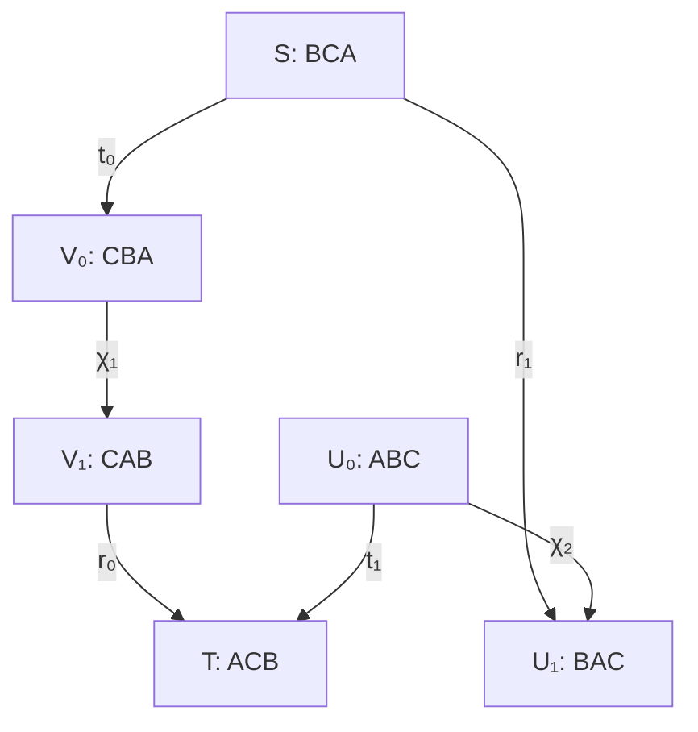

# Free higher categories with directed interchange in every dimension (second round)

*A self-contained problem. No background beyond standard higher category theory is assumed. This is the second version of this prompt: the first, with its answer, is in `../answered/directed-interchange-every-level-2026-11-18.md`. Questions are in §3, smallest first.*

## 1. Setting

**Globular sets and composition.** Work with reflexive globular sets with source and target maps s, t, identities, and for k < n a partial composition ∗ₖ of n-cells along k-cells. Composition is written in **diagrammatic order** (u ∗ₖ v means "first u, then v"), and it is strictly associative and unital. The boundary formulas hold: for k < m and (m+1)-cells u, v,

```
s(u ∗ₖ v) = s(u) ∗ₖ s(v),     t(u ∗ₖ v) = t(u) ∗ₖ t(v).        (B)
```

For k < l < n and n-cells in interchange position put `L(a,b,c,d) := (a ∗ₗ b) ∗ₖ (c ∗ₗ d)` and `R(a,b,c,d) := (a ∗ₖ c) ∗ₗ (b ∗ₖ d)`. A strict ω-category requires L = R.

**The Gray case (directed interchange along 0-cells only).** In a category enriched in strict ω-categories with the lax Gray tensor product (Ara–Maltsiniotis, arXiv 1607.00668), for 2-cells α : f ⇒ f′ : x → y and β : g ⇒ g′ : y → z there is a 3-cell

```
χ_{α,β} : (f ◁ β) ∗₁ (α ▷ g′)  ⇛  (α ▷ g) ∗₁ (f′ ◁ β)
```

and nothing in the reverse direction. Composition along k-cells with k ≥ 1 is strict. For a finite globular pasting diagram Γ = ΣΘ₁ ∨ … ∨ ΣΘₙ, the free such structure has homs ν(λΘᵢ₊₁ ⊗ … ⊗ λΘⱼ). Here λ is Steiner's directed complex, ⊗ is Steiner's tensor with `∂(x ⊗ y) = ∂x ⊗ y + (−1)^{|x|} x ⊗ ∂y`, and ν is Steiner's functor to strict ω-categories (Steiner, HHA 2004). Each hom is generated by tuples of cells, and a cell is determined by the set of generators it uses.

**The aim** is the same for directed interchange along k-cells for **every** k, including inside homs.

## 2. What is already known (all proved)

**(K1) Raw higher interchangers are impossible.** If every pair of n-cells in interchange position had an (n+1)-cell L → R, then applying this to identities and using (B) forces L = R one dimension down. That contradicts directedness.

**(K2) A single comparison for each simultaneous variation is impossible.** The obvious repair of (K1) adds, for 3-cells A : a ⇛ a′, …, D : d ⇛ d′ in interchange position, a 4-cell between the parallel 3-cells

```
L(A,B,C,D) ∗₂ χ_{a′}     and     χ_a ∗₂ R(A,B,C,D).        (N)
```

This cannot be required for every instance. Take Γ = ΣD² ∨ ΣD², with two 3-cells A : α ⇛ α′ and B : β ⇛ β′ side by side along a 0-cell, and the instance (A, 1, 1, B). Its two sides map to the hom 2-cells

```
U = (v₀ ∘₀ u₁) ∘₁ c₁₁,     V = c₀₀ ∘₁ (u₀ ∘₀ v₁)
```

of ν(λD² ⊗ λD²), where `u_j = A ⊗ g_j`, `v_i = f_i ⊗ B` and `c_ij = α_i ⊗ β_j`. There is no 4-cell between U and V in either direction: the degree-3 chain would need a positive coefficient at u₀ (or at v₀), but every basis element of degree 3 has a non-positive coefficient there.

**(K3) The two variables have opposite naturality directions.** The degree-3 basis elements are `r_j = A ⊗ β_j` and `t_i = α_i ⊗ B`. Their differentials are

```
∂r_j = c_1j + u₁ − c_0j − u₀,     ∂t_i = c_i0 + v₁ − c_i1 − v₀.
```

So when only A varies, the Gray structure has a naturality 4-cell from the "χ first" side to the "variation first" side (V ⇛ U). When only B varies, it goes the other way (U ⇛ V). The simultaneous variation is the 5-cell A ⊗ B. It goes between two routes of 4-cells, `S → V → T` ⇛ `S → U → T`, where S and T are the composites through c₀₁ and c₁₀. In short, the higher structure is **tensor-shaped**: one Leibniz-signed naturality cell per variable, and higher cells between routes.

**(K4) Supports must use an expanded basis.** If every composite's support were the union of the supports of its parts, L and R would always have equal support. Then "support determines the cell" would force strict interchange.

**(K5) One finite basis forces finitely many cells.** If one finite set B admits injective support maps in every dimension, the structure has finitely many non-identity cells in total.

**(K6) No single directed complex presents the answer, and neither does a hom-wise family of them.** In ν(K), the two composites defining χ have the same chain table, so they are equal. A description must therefore be an iterated tower: objects, then homs presented again by objects and homs, and so on.

**(K7) The first uniform case through hom-dimension 3.** For Γ = ΣD² ∨ ΣD², directing interchange inside the hom 𝒦(x, z) adds exactly two generators of hom-dimension 3 beyond the 25 tensor generators. They are the interchangers χ₁ of (A⊗g, f′⊗B) and χ₂ of (f⊗B, A⊗g′), the only pairs of hom-2-cells composable along a hom-0-cell. Their two sides have different supports. Neither occurs in the boundary of A ⊗ B.

**Literature.** No construction and no impossibility result is known.
- Closest: n-sesquicategories, which have no interchange at all (Araújo, arXiv 2202.09293 and 2210.07704; Forest–Mimram, arXiv 2211.16099 and *Rewriting in Gray categories*, MSCS 2022).
- Crans's teisi.
- Bourke–Lobbia, arXiv 2610.31448: their §4.2.6 lax 4-categories have non-invertible outer interchangers, but invertible interchange inside homs.
- Bourke–Gurski's cocategorical obstruction needs hypotheses not assumed here.

## 3. Questions

Call a structure a **tensor-shaped lax-interchange ω-category** if, for every k < l:
- it has elementary interchangers χ : L ⇛ R for (l+1)-cells, with no reverse cell in free objects;
- for each higher cell, it has one naturality cell per varying argument, oriented by the Leibniz sign of the tensor differential as in (K3);
- for several simultaneous variations, it has higher cells between routes of lower naturality cells, as A ⊗ B does in (K3);
- it satisfies coherence equations, to be determined.

The requirements on the free objects F(Γ), for finite pasting diagrams Γ, are:
1. an explicit combinatorial description by generators with explicit boundaries;
2. two cells of the same dimension that use the same generators, in the expanded basis, are equal;
3. every elementary interchanger exists and its reverse does not;
4. making all interchangers with k ≥ 1 identities gives the free Gray-enriched category, and making all interchangers identities gives the free strict ω-category;
5. closure under substitution of cells for generators.

**Q1 (smallest case).** For Γ = ΣD² ∨ ΣD², start from the 25 tensor generators and χ₁, χ₂ of (K7). Which generators of hom-dimension 4 does the tensor-shaped rule force? Candidates are a naturality cell of χ₁ and χ₂ in each argument, and a comparison relating A ⊗ B to composites through χ₁, χ₂. Give their boundaries, check requirement 2 for them, and check requirement 4 (that they collapse onto A ⊗ B and identities).

**Q2 (definition).** Is there a recursive definition, a "Gray tensor of towers", whose generators are tuples of generators of the F(Θᵢ) with a Leibniz-type boundary, and which gives F(Γ) satisfying 1–5? A definition up to some finite dimension N ≥ 5 counts.

**Q3 (finiteness).** Is there a finite Γ for which the tensor-shaped rule forces infinitely many non-identity cells? By (K5), a yes refutes the finite-basis version of requirement 1.

**Q4 (impossibility).** Can requirements 1–3 alone, without 4 and 5, be shown inconsistent for every choice of higher comparisons? The known negative results (K1, K2) all use requirement 4 or (B).

## 4. What counts as a solution

Any of the following is useful:
- explicit generators for Q1;
- a definition with a combinatorial description for Q2, even in finite dimension;
- a finite Γ for Q3;
- an impossibility proof for Q4;
- a reference to a published construction.

# Researcher Response

**There is a further obstruction in Q1: keeping the free hom-dimensional \(3\)-skeleton described in (K7), one cannot recover \(A\otimes B\) merely by adding hom-dimensional \(4\)-generators.** One of its required boundary routes lifts; the other requires a backwards traversal of a whiskered \(\chi _2\).

The qualification “keeping the \(3\)-skeleton” is essential. The argument below permits no additional equations between its \(2\)-cells and no additional \(3\)-generators. It therefore gives an obstruction to the proposed Q1 extension, **not** an impossibility theorem for every choice of coherence equations in Q4.

All dimensions below are hom-dimensions.

## 1. The relevant boundaries

Write
\[
h_i^j=\alpha_i\otimes g_j,
\qquad
k_j^i=f_i\otimes\beta_j.
\]
These are \(1\)-cells
\[
h_i^j:(0,j)\to(1,j),
\qquad
k_j^i:(i,0)\to(i,1).
\]
The edge \(2\)-cells are
\[
u_j:h_0^j\Rightarrow h_1^j,
\qquad
v_i:k_0^i\Rightarrow k_1^i.
\]

Put
\[
P_{ij}=k_j^0h_i^1,
\qquad
Q_{ij}=h_i^0k_j^1,
\]
where juxtaposition is composition in diagrammatic order. The tensor interchangers have types
\[
c_{ij}:P_{ij}\Rightarrow Q_{ij}.
\]

For compact formulas, define the following whiskered \(2\)-cells:
\[
\begin{aligned}
a_j^-&=k_j^0\triangleleft u_1:
P_{0j}\Rightarrow P_{1j},
&
a_j^+&=u_0\triangleright k_j^1:
Q_{0j}\Rightarrow Q_{1j},
\\
b_i^-&=v_0\triangleright h_i^1:
P_{i0}\Rightarrow P_{i1},
&
b_i^+&=h_i^0\triangleleft v_1:
Q_{i0}\Rightarrow Q_{i1}.
\end{aligned}
\]
Here \(a\) denotes variation by \(A\), and \(b\) variation by \(B\). Write \(x;y\) for composition of \(2\)-cells along dimension \(1\).

The differentials in (K3) give
\[
\boxed{
r_j:
c_{0j};a_j^+
\Longrightarrow
a_j^-;c_{1j},
}
\tag{1}
\]
and
\[
\boxed{
t_i:
b_i^-;c_{i1}
\Longrightarrow
c_{i0};b_i^+.
}
\tag{2}
\]
Thus \(r_j\) moves the \(A\)-variation before the crossing, whereas \(t_i\) moves the \(B\)-variation after it.

Your interchanger convention is
\[
\chi_{x,y}:
(sx\triangleleft y);(x\triangleright ty)
\Longrightarrow
(x\triangleright sy);(tx\triangleleft y).
\tag{3}
\]
It gives the two new \(3\)-generators
\[
\boxed{
\chi_1:
b_0^+;a_1^+
\Longrightarrow
a_0^+;b_1^+,
}
\tag{4}
\]
and
\[
\boxed{
\chi_2:
a_0^-;b_1^-
\Longrightarrow
b_0^-;a_1^-.
}
\tag{5}
\]

The opposite order of the \(A,B\) variations in (4) and (5) is forced by which factor occupies the left position in the relevant composable pair.

## 2. The six \(2\)-cell routes

There are six sequential \(2\)-cells from \(P_{00}\) to \(Q_{11}\), corresponding to the orders of the \(A\)-variation, \(B\)-variation, and crossing \(C\):

| Name | Order | \(2\)-cell |
|---|---|---|
| \(S\) | \(BCA\) | \(b_0^-;c_{01};a_1^+\) |
| \(V_0\) | \(CBA\) | \(c_{00};b_0^+;a_1^+\) |
| \(V_1\) | \(CAB\) | \(c_{00};a_0^+;b_1^+\) |
| \(T\) | \(ACB\) | \(a_0^-;c_{10};b_1^+\) |
| \(U_0\) | \(ABC\) | \(a_0^-;b_1^-;c_{11}\) |
| \(U_1\) | \(BAC\) | \(b_0^-;a_1^-;c_{11}\) |

Define the following whiskered \(3\)-cells. In these formulas \(1_x\) is the identity \(3\)-cell on a \(2\)-cell \(x\):
\[
\begin{aligned}
\bar t_0&=t_0*_1 1_{a_1^+}:S\Longrightarrow V_0,
\\
\bar\chi_1&=1_{c_{00}}*_1\chi_1:V_0\Longrightarrow V_1,
\\
\bar r_0&=r_0*_1 1_{b_1^+}:V_1\Longrightarrow T,
\\
\bar r_1&=1_{b_0^-}*_1r_1:S\Longrightarrow U_1,
\\
\bar\chi_2&=\chi_2*_1 1_{c_{11}}:U_0\Longrightarrow U_1,
\\
\bar t_1&=1_{a_0^-}*_1t_1:U_0\Longrightarrow T.
\end{aligned}
\tag{6}
\]

Consequently, the directed graph of the relevant \(3\)-steps is:



There is exactly one directed path from \(S\) to \(T\):
\[
\boxed{
\bar t_0*_2\bar\chi_1*_2\bar r_0.
}
\tag{7}
\]
The other proposed route starts with \(\bar r_1\), reaches \(U_1\), and stops. The cell \(\bar t_1\) starts at \(U_0\), and \(\bar\chi_2\) points from \(U_0\) to \(U_1\).

## 3. Why this exhausts the relevant \(3\)-cells

This is more than a failure of one proposed expression.

Assign coordinates
\[
P_{ij}\longleftrightarrow(i,j,0),
\qquad
Q_{ij}\longleftrightarrow(i,j,1).
\]
The three coordinates record the \(A\)-variation, \(B\)-variation, and crossing. Every generating \(2\)-step increases exactly one coordinate. Each coordinate can increase only once.

The six \(3\)-generators orient the square faces of this directed cube:
\[
\begin{array}{c|c}
\text{Generator}&\text{Change of order}\\ \hline
r_j&CA\longrightarrow AC\\
t_i&BC\longrightarrow CB\\
\chi_2&AB\longrightarrow BA\quad(C=0)\\
\chi_1&BA\longrightarrow AB\quad(C=1).
\end{array}
\tag{8}
\]

Two nonidentity \(3\)-generators cannot compose along dimension \(0\): all have \(0\)-source \(00\) and \(0\)-target \(11\).

They also cannot compose along dimension \(1\). Each changes two coordinates between its \(1\)-source and \(1\)-target. Composing two along dimension \(1\) would require at least four coordinate increases, but only three are available.

Thus multiple nonidentity \(3\)-generators can combine only along dimension \(2\). Lower compositions only whisker a generating \(3\)-cell by identities on \(2\)-cells. A generating \(3\)-cell already uses two coordinate increases, leaving at most one for these whiskers. The resulting steps in the full interval are exactly (6).

These counts concern the directed cube and, equivalently, positive chain coefficients in the strict quotient. **They do not assume the union-of-supports rule excluded by (K4).**

If horizontal \(2\)-composition is retained as a primitive, terms such as
\[
u_0*_0v_1,\qquad v_0*_0u_1
\]
may also be present. Their mere existence supplies no additional \(3\)-step: none of the stipulated six \(3\)-generators compares them with the sequential routes. Adding such comparisons would change the stipulated \(3\)-skeleton.

For the specific missing boundary there is an additional direct check. A \(3\)-cell mapping to the positive boundary of \(A\otimes B\) must use \(r_1,t_1\) once each and use neither \(r_0\) nor \(t_0\), because their coefficients in the strict tensor are independent and nonnegative. Starting at \(S\), its first such step must therefore be \(\bar r_1\). It reaches \(U_1\), from which the remaining required step \(\bar t_1\) is inaccessible.

## 4. The generator \(A\otimes B\) has no lift

Let
\[
q:\widetilde{\mathcal K}\longrightarrow
\nu(\lambda D^2\otimes\lambda D^2)
\]
be the intended quotient. It identifies
\[
q(V_0)=q(V_1)=V,
\qquad
q(U_0)=q(U_1)=U.
\]

In the strict tensor, the degree-\(4\) generator
\[
w=A\otimes B
\]
has boundary
\[
\boxed{
w:
q(\bar t_0)*_2q(\bar r_0)
\Longrightarrow
q(\bar r_1)*_2q(\bar t_1).
}
\tag{9}
\]
This agrees with
\[
\partial w=t_1-t_0+r_1-r_0.
\]

Its negative boundary has the lift (7). The expected positive lift would be
\[
\bar r_1*_2
\bar\chi_2^{-1}*_2
\bar t_1,
\tag{10}
\]
but there is no \(3\)-cell with the required reversed boundary in the stipulated \(3\)-skeleton. Section 3 rules out an alternative expression with the required strict image.

Therefore a proposed \(4\)-generator lifting \(w\) cannot be typed.

Adding a \(4\)-cell does not repair this: its source and target must already be parallel \(3\)-cells. A higher comparison cannot supply the missing \(3\)-boundary retroactively.

### Recovering \(w\) as a composite does not repair the fixed presentation

The same calculation also addresses the possibility that \(w\) might arise only as a composite after quotienting.

Every interval in the cube changes zero, one, two, or three coordinates:

- With zero or one change, there is no nonidentity \(3\)-step.
- With two changes, there are two sequential \(2\)-paths and one directed \(3\)-edge.
- With three changes, the graph is the six-vertex graph above, which has at most one directed path between any ordered pair of vertices.

Consequently, parallel \(3\)-cells generated by this fixed presentation have the same image under \(q\). Different expressions formed from identities do not affect this conclusion.

Thus every additional \(4\)-generator with a boundary in this \(3\)-skeleton would have an **endomorphic** image:
\[
q(s_3z)=q(t_3z).
\tag{11}
\]
Composites of such images remain endomorphisms, including composites whose composability becomes available only after imposing the quotient equations.

But \(w\) is not an endomorphism. Its two \(3\)-boundaries have different degree-\(3\) chains:
\[
t_0+r_0\ne r_1+t_1.
\tag{12}
\]
Hence a quotient of the presentation, obtained by imposing equations and forming the resulting composites, cannot recover \(w\) this way either. Adjoining new generators *after* quotienting would be a further extension.

## 5. The proposed naturalities of \(\chi_1,\chi_2\)

The arguments of \(\chi_1\) lie in the edge homs
\[
u_0\in\operatorname{Hom}(00,10),
\qquad
v_1\in\operatorname{Hom}(10,11),
\]
and those of \(\chi_2\) lie in
\[
v_0\in\operatorname{Hom}(00,01),
\qquad
u_1\in\operatorname{Hom}(01,11).
\]

None of these four edge homs has a nonidentity \(3\)-generator. All of
\[
r_0,r_1,t_0,t_1,\chi_1,\chi_2
\]
span \(00\to11\), so none can be a \(3\)-variation of one of those arguments.

Therefore **there are no nonidentity argument variations here that force new \(4\)-naturality generators for \(\chi_1\) or \(\chi_2\)**. Identity-variation instances concern normalization and do not supply the missing \(3\)-route.

The simultaneous variation of the original crossing \(c\) in \(A,B\) is different. That is precisely the datum represented by \(w\), whose boundary fails to lift.

Requirement 2 cannot remedy this failure. Refining a support basis can distinguish existing cells; it does not create a missing cell of the required type.

## 6. Scope: what this proves about Q1–Q4

### Q1: the stated fixed-skeleton extension fails

Under the interpretation that (K7) supplies the free \(3\)-skeleton, with exactly the listed \(3\)-generators and no additional \(2\)-equations, **there is no hom-dimensional \(4\)-generator list satisfying requirement 4**. The obstruction is already a missing globular boundary.

This is independent of how one tries to assign supports to the prospective \(4\)-generators.

### Q2: a different construction must change lower-dimensional data

A construction could evade the obstruction by adding further \(3\)-cells. For example, a new cell
\[
h:S\Longrightarrow U_0
\]
with intended strict image \(q(\bar r_1)\) would make
\[
h*_2\bar t_1:S\Longrightarrow T
\]
available. This is additional \(3\)-dimensional data beyond (K7); no coherence or substitution theorem for that repair has been established here.

Another possibility is an extra equation between \(2\)-cells, such as \(U_0=U_1\). That also changes the \(3\)-skeleton before attempting the \(4\)-dimensional extension.

Allowing an inverse to the unwhiskered \(\chi_2\) makes (10) available, but abandons the requested directedness for that interchanger. Bourke–Lobbia’s lax \(4\)-categories retain ordinary Gray-categories as homs while weakening the outer comparison data, so their construction does not establish the version with recursively directed hom interchangers. [arxiv.org](https://arxiv.org/html/2610.31448v2?utm_source=chatgpt.com)

### Q3: no infinitude conclusion follows

The calculation forces a change to the proposed lower-dimensional presentation if the Gray quotient is retained. It does not prove that infinitely many nonidentity cells are forced.

### Q4: this is not a no-go for requirements 1–3 alone

In particular, one must not infer cancellation of the \(c_{11}\) whisker. A reverse of
\[
\bar\chi_2=\chi_2*_1 1_{c_{11}},
\]
or an equation identifying its endpoints, does **not** by itself give a reverse of the unwhiskered \(\chi_2\).

Thus the proved obstruction is:

\[
\boxed{
\begin{gathered}
\text{the free \(3\)-skeleton of (K7)}
\\
+\ \text{the stated tensor orientations}
\\
+\ \text{extension only in dimensions \(4\) and above}
\\
\Longrightarrow\quad
\text{failure to recover }A\otimes B\text{ under the Gray quotient}.
\end{gathered}
}
\]

Arbitrary completions that add \(2\)-equations or further \(3\)-generators remain outside this obstruction.

---

## Verification of the researcher response (2026-11-18)

**Verdict: correct, as scoped by the researcher.** The response proves an obstruction for one specific extension (keep the free 3-skeleton of (K7) exactly, add only generators of hom-dimension ≥ 4, require the Gray quotient of requirement 4). It does not claim, and does not prove, anything about Q2–Q4 beyond that. Checked step by step:

- **V1. Generator types.** Recomputed from the tensor sign `∂(x⊗y) = ∂x⊗y + (−1)^{|x|} x⊗∂y` in ν(λD²⊗λD²): `c_ij : P_ij = k_j^0 h_i^1 ⇒ Q_ij = h_i^0 k_j^1`, `u_j : h_0^j ⇒ h_1^j`, `v_i : k_0^i ⇒ k_1^i`, `r_j : c_0j ; a_j^+ ⇛ a_j^- ; c_1j`, `t_i : b_i^- ; c_i1 ⇛ c_i0 ; b_i^+`. These agree with (K3) (signs of ∂r_j, ∂t_i) once the whiskers a_j^±, b_i^± are inserted. **Confirmed.**
- **V2. The two interchangers.** χ₁ : b_0^+ ; a_1^+ ⇛ a_0^+ ; b_1^+ and χ₂ : a_0^- ; b_1^- ⇛ b_0^- ; a_1^-, i.e. the Gray orientation of the two hom-2-cell pairs composable along a hom-0-cell, as in (K7). **Confirmed.**
- **V3. Routes and whiskered 3-cells.** The six composite 2-cells (S, T, U₀, U₁, and the two routes through c₀₁ and c₁₀) and the whiskered cells of the response's (6) were recomputed; each whiskered cell has the stated source and target. **Confirmed.**
- **V4. The directed graph argument.** With vertices the composite 2-cells from P to Q and edges the whiskered 3-generators, the only directed path from S to T is t₀, χ̄₁, r₀ (the image of one boundary route of A⊗B). The other route needs r̄₁, χ̄₂ and t̄₁, and it traverses χ̄₂ = χ₂ ∗₁ 1_{c₁₁} backwards. Since ∂(A⊗B) = t₁ − t₀ + r₁ − r₀ in the Steiner complex, both routes are required by requirement 4, and the target route cannot be formed. **Confirmed**, including the point that a 4-generator needs both boundary 3-cells to exist first.
- **V5. Endomorphism step (11)–(12).** The attempt to route through a loop at an intermediate 2-cell fails because the only 3-cells with equal source and target in the free 3-skeleton are identities (no 3-generator is an endomorphism, and composites of generators strictly increase a support count). **Confirmed.**
- **V6. χ-naturalities.** The naturality cells of χ₁, χ₂ in each argument are trivial here: the edge homs carry no 3-generators, so there is nothing to vary. **Confirmed.** So the 4-generators asked for in Q1 reduce to the comparison for A ⊗ B, which is exactly what is obstructed.
- **V7. Literature.** The Bourke–Lobbia remark (homs are ordinary Gray-categories) was not re-checked against arXiv 2610.31448; it is not used in the obstruction.

**Consequences for E6.** The (K7) 3-skeleton is not the right one: any tensor-shaped construction for ΣD² ∨ ΣD² must change hom-dimension-3 data (an extra 3-generator such as h : S ⇛ U₀ with strict image r̄₁, or a 2-equation such as U₀ = U₁) before dimension 4. (K7) itself (exactly two extra 3-generators for *interchange*) still stands; what fails is "and nothing else in dimension 3". Q2–Q4 remain open. Follow-up prompt: `outbox/directed-interchange-every-level-r3.md` (round 3), unsent.
