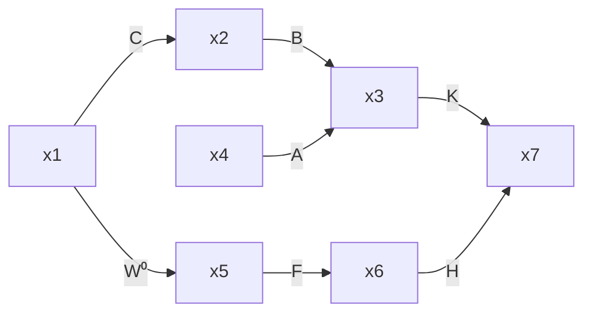

# Free higher categories with directed interchange in every dimension (fourth round)

*A self-contained problem. No background beyond standard higher category theory is assumed. Rounds 1–3, with their answers, are in `answered/`. Questions are in §4, smallest first.*

## 1. Setting

**Globular sets and composition.** Work with reflexive globular sets with source and target maps s, t, identities, and for k < n a partial composition ∗ₖ of n-cells along k-cells. Composition is written in **diagrammatic order** (u ∗ₖ v means "first u, then v"), and it is strictly associative and unital. The boundary formulas hold: for k < m and (m+1)-cells u, v,

```
s(u ∗ₖ v) = s(u) ∗ₖ s(v),     t(u ∗ₖ v) = t(u) ∗ₖ t(v).        (B)
```

For k < l < n and n-cells in interchange position put `L(a,b,c,d) := (a ∗ₗ b) ∗ₖ (c ∗ₗ d)` and `R(a,b,c,d) := (a ∗ₖ c) ∗ₗ (b ∗ₖ d)`. A strict ω-category requires L = R.

**The Gray case (directed interchange along 0-cells only).** In a category enriched in strict ω-categories with the lax Gray tensor product (Ara–Maltsiniotis, arXiv 1607.00668), for 2-cells α : f ⇒ f′ : x → y and β : g ⇒ g′ : y → z there is a 3-cell

```
χ_{α,β} : (f ◁ β) ∗₁ (α ▷ g′)  ⇛  (α ▷ g) ∗₁ (f′ ◁ β)
```

and nothing in the reverse direction. Composition along k-cells with k ≥ 1 is strict. For a finite globular pasting diagram Γ = ΣΘ₁ ∨ … ∨ ΣΘₙ, the free such structure has homs ν(λΘᵢ₊₁ ⊗ … ⊗ λΘⱼ). Here λ is Steiner's directed complex, ⊗ is Steiner's tensor with `∂(x ⊗ y) = ∂x ⊗ y + (−1)^{|x|} x ⊗ ∂y`, and ν is Steiner's functor to strict ω-categories (Steiner, HHA 2004). Each hom is generated by tuples of cells, and a cell is determined by the set of generators it uses.

**The aim** is the same for directed interchange along k-cells for **every** k, including inside homs.

## 2. What is already known (all proved)

**(K1) Raw higher interchangers are impossible.** If every pair of n-cells in interchange position had an (n+1)-cell L → R, then applying this to identities and using (B) forces L = R one dimension down. That contradicts directedness.

**(K2) A single comparison for each simultaneous variation is impossible.** The obvious repair of (K1) adds, for 3-cells A : a ⇛ a′, …, D : d ⇛ d′ in interchange position, a 4-cell between the parallel 3-cells

```
L(A,B,C,D) ∗₂ χ_{a′}     and     χ_a ∗₂ R(A,B,C,D).        (N)
```

This cannot be required for every instance. Take Γ = ΣD² ∨ ΣD², with two 3-cells A : α ⇛ α′ and B : β ⇛ β′ side by side along a 0-cell, and the instance (A, 1, 1, B). Its two sides map to the hom 2-cells

```
U = (v₀ ∘₀ u₁) ∘₁ c₁₁,     V = c₀₀ ∘₁ (u₀ ∘₀ v₁)
```

of ν(λD² ⊗ λD²), where `u_j = A ⊗ g_j`, `v_i = f_i ⊗ B` and `c_ij = α_i ⊗ β_j`. There is no 4-cell between U and V in either direction: the degree-3 chain would need a positive coefficient at u₀ (or at v₀), but every basis element of degree 3 has a non-positive coefficient there.

**(K3) The two variables have opposite naturality directions.** The degree-3 basis elements are `r_j = A ⊗ β_j` and `t_i = α_i ⊗ B`. Their differentials are

```
∂r_j = c_1j + u₁ − c_0j − u₀,     ∂t_i = c_i0 + v₁ − c_i1 − v₀.
```

So when only A varies, the Gray structure has a naturality 4-cell from the "χ first" side to the "variation first" side (V ⇛ U). When only B varies, it goes the other way (U ⇛ V). The simultaneous variation is the 5-cell A ⊗ B. It goes between two routes of 4-cells, `S → V → T` ⇛ `S → U → T`, where S and T are the composites through c₀₁ and c₁₀. In short, the higher structure is **tensor-shaped**: one Leibniz-signed naturality cell per variable, and higher cells between routes.

**(K4) Supports must use an expanded basis.** If every composite's support were the union of the supports of its parts, L and R would always have equal support. Then "support determines the cell" would force strict interchange.

**(K5) One finite basis forces finitely many cells.** If one finite set B admits injective support maps in every dimension, the structure has finitely many non-identity cells in total.

**(K6) No single directed complex presents the answer, and neither does a hom-wise family of them.** In ν(K), the two composites defining χ have the same chain table, so they are equal. A description must therefore be an iterated tower: objects, then homs presented again by objects and homs, and so on.

**(K7) The first uniform case through hom-dimension 3.** For Γ = ΣD² ∨ ΣD², directing interchange inside the hom 𝒦(x, z) adds exactly two generators of hom-dimension 3 beyond the 25 tensor generators. They are the interchangers χ₁ of (A⊗g, f′⊗B) and χ₂ of (f⊗B, A⊗g′), the only pairs of hom-2-cells composable along a hom-0-cell. Their two sides have different supports. Neither occurs in the boundary of A ⊗ B.

**(K8) The (K7) 3-skeleton cannot be extended by 4-generators alone (round 2, proved).** Write h_i^j = α_i ⊗ g_j, k_j^i = f_i ⊗ β_j, P_ij = k_j^0 h_i^1, Q_ij = h_i^0 k_j^1, so c_ij : P_ij ⇒ Q_ij. The tensor 3-generators are r_j : c_0j ; a_j^+ ⇛ a_j^- ; c_1j and t_i : b_i^- ; c_i1 ⇛ c_i0 ; b_i^+ (a_j^±, b_i^± the whiskered edge cells u_j, v_i), and the interchangers are χ₁ : b_0^+ ; a_1^+ ⇛ a_0^+ ; b_1^+ and χ₂ : a_0^- ; b_1^- ⇛ b_0^- ; a_1^-. The six composite hom-2-cells P₀₀ ⇒ Q₁₁ are S = b_0^- ; c_01 ; a_1^+, V₀ = c_00 ; b_0^+ ; a_1^+, V₁ = c_00 ; a_0^+ ; b_1^+, T = a_0^- ; c_10 ; b_1^+, U₀ = a_0^- ; b_1^- ; c_11 and U₁ = b_0^- ; a_1^- ; c_11. Whiskering gives t̄₀ : S ⇛ V₀, χ̄₁ : V₀ ⇛ V₁, r̄₀ : V₁ ⇛ T, r̄₁ : S ⇛ U₁, χ̄₂ = χ₂ ∗₁ 1_{c₁₁} : U₀ ⇛ U₁ and t̄₁ : U₀ ⇛ T. Since ∂(A⊗B) = t₁ − t₀ + r₁ − r₀, requirement 4 forces a 4-cell between the route t̄₀, χ̄₁, r̄₀ from S to T and a route from S to T using r̄₁ and t̄₁. In the free 3-skeleton with exactly the 25 tensor generators plus χ₁, χ₂ and no 2-equations, the first route exists, but the second would have to go S ⇛ U₁ and then U₁ ⇛ U₀ against χ̄₂: in the directed graph of these composites the only S → T path is t̄₀, χ̄₁, r̄₀. So no list of 4-generators recovers A ⊗ B. The naturality cells of χ₁, χ₂ are trivial here (the edge homs have no 3-generators).

The repair must change dimension-3 data: an extra 3-generator such as h : S ⇛ U₀ whose image under the Gray quotient is r̄₁, or a 2-equation such as U₀ = U₁. Inverting χ₂ would also work but breaks requirement 3.

**(K9) The orientation of χ₁, χ₂ in (K7) is forced by substitution (proved).** One might try to avoid (K8) by orienting every inner interchanger by the factor order of the enclosing tensor (always "Θ₂-cell first ⇛ Θ₁-cell first"), which keeps χ₁ and reverses χ₂. This fails requirement 5. The free object on Σ(D² ∨ D²) has, inside its hom, the interchanger of its two 2-cells A′ (left) and B′ (right), oriented as in the Gray case: "B′ first ⇛ A′ first". The assignment A′ ↦ f₀ ⊗ B and B′ ↦ A ⊗ g₁ (with the hom-0-cells and hom-1-cells sent to f₀⊗g₀, f₀⊗g₁, f₁⊗g₁ and to the matching edges) respects all boundaries, so substitution sends that interchanger to a 3-cell from "A ⊗ g₁ first" to "f₀ ⊗ B first", which is exactly χ₂ in its (K7) orientation. The pair χ₁ is forced the same way via A′ ↦ A ⊗ g₀, B′ ↦ f₁ ⊗ B. So χ₂ cannot be reversed: adding the reversed cell as well breaks requirement 3, which is the "inverting χ₂" option above. Inner interchangers are oriented by position (right cell first ⇛ left cell first), as at the outer level, and some repair of dimension-3 data is needed (see (K10)).

**(K10) The smallest case is repaired by a factorization (round 3, proved).** The six hom-2 composites P₀₀ ⇒ Q₁₁ of (K8) are the maximal paths of an oriented 3-cube with coordinates A (edges a_j^±), B (edges b_i^±) and C (edges c_ij): S = BCA, V₀ = CBA, V₁ = CAB, T = ACB, U₀ = ABC, U₁ = BAC. The six whiskered hom-3 cells t̄₀, χ̄₁, r̄₀, r̄₁, χ̄₂, t̄₁ are its six square faces (adjacent transpositions); every proper interval carries at most one of them. Add one hom-3 generator and one hom-3 equation:

```
h : S ⇛ U₀,        r̄₁ = h ∗₂ χ̄₂.        (F)
```

Then the maximal hom-3 interval is the free category on S → V₀ → V₁ → T, S → U₀ → U₁, U₀ → T, with 11 non-identity cells with pairwise distinct label sets, two routes S → T (t̄₀ ; χ̄₁ ; r̄₀ and h ; t̄₁), and no reverse of χ̄₁ or χ̄₂. Killing the inner interchangers gives exactly the free Gray diamond with q(h) = q(r̄₁), and A ⊗ B lifts to one 4-generator W : t̄₀ ; χ̄₁ ; r̄₀ ⇛ h ; t̄₁ with no non-identity contexts. Supports use one label per whiskered context, so r̄₁ is no longer a basis element (its support is that of h χ̄₂). The equation (F) cannot be dropped or replaced by a 4-cell h χ̄₂ ⇛ r̄₁ without a new class of cells killed by the quotient. h is not an interchanger: S and U₀ each contain a c_ij, and every hom-2 path containing a c_ij spans the whole external hom-0 interval.

h is **not forced**. The mirror repair k : U₁ ⇛ T with t̄₁ = χ̄₂ ∗₂ k works equally well, and so does the symmetric repair with both h and k and both equations (12 cells, second route h ; χ̄₂ ; k, same exact Gray quotient). The alternative 2-equation U₀ = U₁ makes χ̄₂ an endomorphism and needs further equations (at least χ̄₂² = χ̄₂ under set supports), so it is not preferred.

**Literature.** No construction and no impossibility result is known.
- Closest: n-sesquicategories, which have no interchange at all (Araújo, arXiv 2202.09293 and 2210.07704; Forest–Mimram, arXiv 2211.16099 and *Rewriting in Gray categories*, MSCS 2022).
- Crans's teisi.
- Bourke–Lobbia, arXiv 2610.31448: their §4.2.6 lax 4-categories have non-invertible outer interchangers, but invertible interchange inside homs.
- Bourke–Gurski's cocategorical obstruction needs hypotheses not assumed here.

## 3. Requirements

A **tensor-shaped lax-interchange ω-category** has, for every k < l, elementary interchangers χ : L ⇛ R for (l+1)-cells with no reverse cell in free objects; one naturality cell per varying argument, oriented by the Leibniz sign; higher cells between routes of lower naturality cells; and coherence equations to be determined. The free objects F(Γ) must satisfy:
1. an explicit combinatorial description by generators with explicit boundaries;
2. two cells of the same dimension using the same generators, in the expanded basis, are equal;
3. every elementary interchanger exists and its reverse does not;
4. making all interchangers with k ≥ 1 identities gives the free Gray-enriched category, and making all interchangers identities gives the free strict ω-category;
5. closure under substitution of cells for generators.

## 4. Questions

**Q1 (the uniform rule).** State a rule, in terms of the cube or tensor combinatorics, saying which whiskered tensor cells must factor through which whiskered inner interchangers. A candidate: whenever a whiskered tensor face d and a whiskered interchanger face e of the same cube interval share a target (or source), adjoin a factor h with d = h e (or k with d = e k). Is the h-type, the k-type or the symmetric version the right one? An equivalent formulation: the hom-2 paths of a cube interval are words in its coordinates, its faces are adjacent transpositions (the 2-faces of a permutohedron), and in ΣD² ∨ ΣD² the tensor pairs are oriented consistently while the interchanger pair flips when the third coordinate crosses it, so the hexagon has two sources and two sinks instead of one of each; h joins the two sources and k the two sinks. Does "every 2-face with a position-dependent pair gets a source-joining (or sink-joining) factorization, and the resulting diamond gets one 4-generator" extend to cubes with four or more coordinates, where square 2-faces (disjoint transpositions) also appear? Test the rule on the next cases: Γ = ΣD³ ∨ ΣD² (where the hom contains λD³ ⊗ λD² and the relevant cubes are larger), and Γ = ΣD² ∨ ΣD² ∨ ΣD² (three summands, hom ν(λD² ⊗ λD² ⊗ λD²), where interchangers of different pairs meet in one 4-dimensional cube). In each case give the added generators and equations through hom-dimension 4 and check requirements 2–4.

**Q2 (substitution).** Requirement 5 requires every substitution F to preserve (F): F(r̄₁) = F(h) ; F(χ̄₂). Do the substitutions of (K9), or others between free objects on small Γ, force one of the h-type, k-type or symmetric repairs, or rule all of them out? In particular, if a substitution sends a cube of one shape onto a degenerate or larger interval of another, is the image of h determined?

**Q3 (definition).** Is there a recursive "Gray tensor of towers" whose generators include the factorizations of Q1 uniformly, giving F(Γ) with requirements 1–5, up to some finite dimension N ≥ 5?

**Q4 (impossibility).** Can requirements 1–3 and 5 be shown inconsistent without requirement 4? (K1), (K2) and (K8) all use requirement 4 or (B).

## 5. What counts as a solution

Explicit generators and equations for Q1 in either test case; a forcing or refuting substitution for Q2; a definition for Q3, even in finite dimension; an impossibility proof for Q4; or a reference to a published construction.

# Researcher Response

**The first test case admits an explicit completion in the same contextual-presentation sense as K10.** For
\[
\Gamma=\Sigma D^3\vee\Sigma D^2,
\]
start with the \(h\)-repair on each of the two \(D^2\otimes D^2\) boundary diagrams. Add two hom-4 generators \(H,K\) and two hom-4 equations. These supply parallel boundaries for the hom-5 generator \(\Omega\otimes B\).

The construction also admits the degeneration \(\Omega\mapsto1_A\). Under that substitution,
\[
H\longmapsto1_h,\qquad K\longmapsto W.
\]

I give the generators, boundaries, equations, support proof, and quotient below. This does not establish a rule closed under arbitrary substitution, or settle the three-summand case.

## 1. The larger diagram is a variation of the repaired cube

Write the first factor \(D^3\) as
\[
\alpha_0,\alpha_1:f_0\to f_1,\qquad
A^0,A^1:\alpha_0\Rightarrow\alpha_1,\qquad
\Omega:A^0\Rrightarrow A^1,
\]
and the second factor \(D^2\) as
\[
\beta_0,\beta_1:g_0\to g_1,\qquad
B:\beta_0\Rightarrow\beta_1.
\]

These dimensions are **hom dimensions**. Thus \(\Omega\) has hom-dimension \(3\).

Increasing the first globe from \(D^2\) to \(D^3\) introduces two parallel choices \(A^0,A^1\) and a variation between them. It does not introduce a fourth independent hom-2 coordinate. Accordingly, the relevant hom-3 graph consists of two copies of the repaired cube graph, joined by six whiskerings of \(\Omega\).

For \(\epsilon=0,1\), use the notation
\[
S^\epsilon,V_0^\epsilon,V_1^\epsilon,T^\epsilon,U_0^\epsilon,U_1^\epsilon
\]
for the six paths formed using \(A^\epsilon\). Abbreviate their hom-3 arrows by
\[
\begin{array}{c|c|c}
\text{Symbol}&\text{Original notation}&\text{Boundary}\\ \hline
a^\epsilon&\bar t_0&S^\epsilon\to V_0^\epsilon\\
b^\epsilon&\bar\chi_1^\epsilon&V_0^\epsilon\to V_1^\epsilon\\
c^\epsilon&\bar r_0^\epsilon&V_1^\epsilon\to T^\epsilon\\
d^\epsilon&\bar r_1^\epsilon&S^\epsilon\to U_1^\epsilon\\
e^\epsilon&\bar\chi_2^\epsilon&U_0^\epsilon\to U_1^\epsilon\\
f^\epsilon&\bar t_1&U_0^\epsilon\to T^\epsilon .
\end{array}
\]
The \(\epsilon\)-dependence of \(a^\epsilon,f^\epsilon\) is in their whiskering contexts.

Apply K10 separately:
\[
h^\epsilon:S^\epsilon\longrightarrow U_0^\epsilon,
\qquad
\boxed{d^\epsilon=h^\epsilon e^\epsilon.} \tag{1}
\]

Hereafter:

- juxtaposition of hom-3 cells denotes \(*_2\);
- a semicolon between hom-4 cells denotes \(*_3\);
- \(u\Phi v\), with \(\Phi\) a hom-4 cell and \(u,v\) hom-3 cells, denotes whiskering along hom-dimension \(2\).

All orders are diagrammatic.

### The six vertical hom-3 cells

Put
\[
\rho_j=\Omega\otimes g_j:
u_j^0\longrightarrow u_j^1.
\]
Their whiskerings give
\[
\omega_j^-:a_j^{-,0}\longrightarrow a_j^{-,1},
\qquad
\omega_j^+:a_j^{+,0}\longrightarrow a_j^{+,1}.
\]

For each \(X\in\{S,V_0,V_1,T,U_0,U_1\}\), let
\[
z_X:X^0\longrightarrow X^1
\]
be obtained by replacing the unique \(A^0\)-edge by its \(\omega\)-variation. Explicitly, using brackets for hom-2 whiskering,
\[
\begin{aligned}
z_S&=[b_0^-;c_{01};\omega_1^+],&
z_{V_0}&=[c_{00};b_0^+;\omega_1^+],\\
z_{V_1}&=[c_{00};\omega_0^+;b_1^+],&
z_T&=[\omega_0^-;c_{10};b_1^+],\\
z_{U_0}&=[\omega_0^-;b_1^-;c_{11}],&
z_{U_1}&=[b_0^-;\omega_1^-;c_{11}].
\end{aligned} \tag{2}
\]

After normalizing (1), the maximal hom-3 graph has:

- six arrows \(a^\epsilon,b^\epsilon,c^\epsilon,h^\epsilon,e^\epsilon,f^\epsilon\) in each layer;
- the six arrows \(z_X:X^0\to X^1\).

This is the hom-3 graph used in the calculations below.

## 2. The hom-4 tensor and interchange generators

The tensor generators of hom-dimension \(4\) are
\[
R_j=\Omega\otimes\beta_j\quad(j=0,1),
\qquad
W^\epsilon=A^\epsilon\otimes B\quad(\epsilon=0,1).
\]

The repaired boundaries of \(W^\epsilon\) are
\[
\boxed{
W^\epsilon:
a^\epsilon b^\epsilon c^\epsilon
\Longrightarrow
h^\epsilon f^\epsilon.
} \tag{3}
\]

The boundaries of \(R_j\) are
\[
R_j:
r_j^0[\omega_j^-;c_{1j}]
\Longrightarrow
[c_{0j};\omega_j^+]r_j^1. \tag{4}
\]
Their orientation follows directly from
\[
\partial(\Omega\otimes\beta_j)
=
(A^1-A^0)\otimes\beta_j
-\Omega\otimes(g_1-g_0). \tag{5}
\]

There are also four inner hom-4 generators.

Two are the one-variable naturalities of \(\chi_1,\chi_2\):
\[
\begin{aligned}
N_1:\quad&
\chi_1^0[\omega_0^+;b_1^+]
\Longrightarrow
[b_0^+;\omega_1^+]\chi_1^1,\\
N_2:\quad&
[\omega_0^-;b_1^-]\chi_2^1
\Longrightarrow
\chi_2^0[b_0^-;\omega_1^-].
\end{aligned} \tag{6}
\]
Their directions are opposite because \(\Omega\) varies the left input in the first pair and the right input in the second pair, as in K3.

The other two are elementary interchangers between the independent hom-3 cells:

- \(t_0\) and the appropriate whiskering of \(\Omega\);
- the appropriate whiskering of \(\Omega\) and \(t_1\).

For the maximal interval, these four inner generators and the two \(R_j\) give the following six hom-4 faces.

| Face | Hom-3 source | Hom-3 target | Origin |
|---|---|---|---|
| \(\mathsf A\) | \(z_Sa^1\) | \(a^0z_{V_0}\) | Inner interchange |
| \(\mathsf B\) | \(b^0z_{V_1}\) | \(z_{V_0}b^1\) | Whiskered \(N_1\) |
| \(\mathsf C\) | \(c^0z_T\) | \(z_{V_1}c^1\) | Whiskered \(R_0\) |
| \(\mathsf D\) | \(h^0e^0z_{U_1}\) | \(z_Sh^1e^1\) | Whiskered \(R_1\), using (1) |
| \(\mathsf E\) | \(z_{U_0}e^1\) | \(e^0z_{U_1}\) | Whiskered \(N_2\) |
| \(\mathsf F\) | \(f^0z_T\) | \(z_{U_0}f^1\) | Inner interchange |

The positional orientation gives \(\mathsf A,\mathsf F\). Equations (5)–(6) give the other four directions.

## 3. First new hom-4 generator: variation of the factorization

Add
\[
\boxed{
H:h^0z_{U_0}\Longrightarrow z_Sh^1
} \tag{7}
\]
and impose
\[
\boxed{
He^1=(h^0\mathsf E)\,;\,\mathsf D.
} \tag{8}
\]

Both sides have source and target
\[
h^0z_{U_0}e^1
\Longrightarrow
z_Sh^1e^1.
\]
The right side passes through
\[
h^0e^0z_{U_1}.
\]

Thus the relevant hom-4 graph is
\[
h^0z_{U_0}e^1
\xrightarrow{\,h^0\mathsf E\,}
h^0e^0z_{U_1}
\xrightarrow{\,\mathsf D\,}
z_Sh^1e^1,
\]
and equation (8) identifies the whiskering \(He^1\) with this two-step path.

This is the compatibility equation for the variation of
\[
d^\epsilon=h^\epsilon e^\epsilon.
\]
It is additional information beyond the rule that merely adjoins factors to pairs of faces.

In the Gray quotient, \(e^1\) and \(\mathsf E\) become identities, so
\[
\boxed{q(H)=q(\mathsf D).} \tag{9}
\]
Consequently \(H\) contributes no extra hom-4 generator to that quotient.

## 4. A second factorization is needed for the top tensor boundary

Adding \(H\) does not yet provide both boundary routes for \(\Omega\otimes B\).

The seven hom-3 paths from \(S^0\) to \(T^1\) are
\[
\begin{aligned}
x_1&=a^0b^0c^0z_T,\\
x_2&=a^0b^0z_{V_1}c^1,\\
x_3&=a^0z_{V_0}b^1c^1,\\
x_4&=z_Sa^1b^1c^1,\\
x_5&=h^0f^0z_T,\\
x_6&=h^0z_{U_0}f^1,\\
x_7&=z_Sh^1f^1.
\end{aligned} \tag{10}
\]

The contextual inner face
\[
\overline{\mathsf A}:=\mathsf A b^1c^1:x_4\longrightarrow x_3
\]
and the contextual tensor face
\[
z_SW^1:x_4\longrightarrow x_7
\]
have the same source.

Apply a **\(k\)-type factorization** to this pair. Add
\[
\boxed{
K:x_3\Longrightarrow x_7
} \tag{11}
\]
and impose
\[
\boxed{
z_SW^1=(\mathsf A b^1c^1)\,;\,K.
} \tag{12}
\]

After replacing the contextual arrow \(z_SW^1\) by the right side of (12), the maximal hom-4 graph is:



The labels in this diagram include the whiskerings displayed in (10). Precisely, its two \(x_1\to x_7\) paths are
\[
L=(W^0z_T)\,;\,(h^0\mathsf F)\,;\,(Hf^1)
\]
and
\[
R=(a^0b^0\mathsf C)\,;\,(a^0\mathsf Bc^1)\,;\,K. \tag{13}
\]

This gives the requested additional hom-4 data. It also permits the hom-5 generator
\[
\boxed{Z:L\Longrightarrow R.} \tag{14}
\]

### What this says about the proposed rule

This example uses:

- \(h\)-type factorizations in hom-dimension \(3\);
- a compatibility equation for their variation, namely (8);
- a \(k\)-type factorization in hom-dimension \(4\), namely (12).

A recipe restricted to **\(h\)-type factorizations of individual tensor faces** misses the pair in (12). A source-joining alternative would instead need to factor the composite
\[
(a^0b^0\mathsf C)\,;\,(a^0\mathsf Bc^1)
\]
through \(\overline{\mathsf A}\). That is a factorization of a composite, rather than a single tensor face.

Thus this calculation does not select \(h\), \(k\), or the symmetric choice uniformly. It shows that a rule must specify both:

1. which mixed face factorizations it adds;
2. how an existing factorization varies, including equations such as (8).

## 5. Complete generator inventory through hom-dimension 4

The inventory is finite.

| Hom dimension | Tensor generators | Added inner generators | Added factorization generators |
|---|---:|---:|---:|
| \(0\) | \(4\) | \(0\) | \(0\) |
| \(1\) | \(8\) | \(0\) | \(0\) |
| \(2\) | \(10\) | \(0\) | \(0\) |
| \(3\) | \(8\) | \(4\) | \(2\) |
| \(4\) | \(4\) | \(4\) | \(2\) |

More explicitly, the positive-dimensional additions are:

- **Hom-dimension 3:** \(\chi_1^\epsilon,\chi_2^\epsilon,h^\epsilon\), for \(\epsilon=0,1\), with equations (1).
- **Hom-dimension 4:** \(N_1,N_2,\mathsf A,\mathsf F,H,K\), with equations (8) and (12).
- The existing tensor labels \(W^\epsilon\) receive the repaired boundaries (3).
- If the top tensor generator is included, its label \(Z=\Omega\otimes B\) receives boundary (14).

Here \(\mathsf B,\mathsf C,\mathsf D,\mathsf E\) are specified whiskerings, not four further independent generators.

## 6. Normal forms, supports, and directedness

The support convention is the one already accepted in K10: distinct whiskering contexts have distinct basis records, and equations may make a particular contextual record composite.

In hom-dimension \(3\), normalize
\[
d^\epsilon\rightsquigarrow h^\epsilon e^\epsilon.
\]

In hom-dimension \(4\), normalize the two contextual records
\[
\boxed{
He^1\rightsquigarrow(h^0\mathsf E)\,;\,\mathsf D,
\qquad
z_SW^1\rightsquigarrow(\mathsf A b^1c^1)\,;\,K.
} \tag{15}
\]

These reductions do **not** eliminate \(H\) or \(W^1\) themselves. They eliminate only the indicated contextual records.

### Why there are no overlaps in this example

For the first reduction:

- its hom-3 boundary interval is \(S^0\to U_1^1\);
- no nonidentity hom-3 arrow enters \(S^0\) or leaves \(U_1^1\);
- its hom-4 source has no incoming hom-4 arrow, and its target has no outgoing one.

For the second:

- its hom-3 boundary interval is \(S^0\to T^1\);
- no nonidentity hom-3 arrow enters \(S^0\) or leaves \(T^1\);
- \(x_4\) has no incoming hom-4 arrow, and \(x_7\) has no outgoing one.

Both lower hom-1 boundaries are the full interval \(P_{00}\to Q_{11}\), so neither equation has an additional nonidentity lower whiskering context. The right sides of (15) use neither eliminated record. Therefore the reductions terminate and have no overlaps.

The remaining proper intervals are also explicit. The four square faces involving the \(A\)-coordinate each have two horizontal hom-3 arrows and two \(\Omega\)-variation arrows; each carries one hom-4 comparison, respectively \(R_0,R_1,N_1,N_2\). The other proper intervals contribute no additional hom-4 ambiguity.

### Support injectivity

For each normal contextual generator \(g\), use its own graded label and include its recursively determined boundary supports. Define support of a normal path by union, and identity support by
\[
\operatorname{supp}(1_u)=\operatorname{supp}(u).
\]

Every resulting hom-3 and hom-4 graph is acyclic. A nonempty directed path in an acyclic graph is determined by its set of directed edges: it cannot revisit a vertex, and its edges determine their order. Distinct intervals use distinct contextual labels. Identities are distinguished recursively.

This proves support injectivity through hom-dimension \(4\) for this finite presentation.

The exhaustive counts **within the maximal hom-1 interval \(P_{00}\to Q_{11}\)** are:

| Quantity | Count |
|---|---:|
| Hom-3 cells, including identities | \(68\) |
| Contextual hom-4 generating records before (15) | \(23\) |
| Contextual hom-4 generating records after (15) | \(21\) |
| Normal hom-4 cells, including identities | \(98\) |
| Nonidentity normal hom-4 cells | \(30\) |
| Distinct supports of those hom-3 cells | \(68\) |
| Distinct supports of those hom-4 cells | \(98\) |

These counts, the boundary checks, acyclicity, support injectivity, and the degeneration below are reproduced by the complete checker d3_d2_interchange_check.mjs[d3_d2_interchange_check.mjs](sandbox:/workspace/scratch/81530e09e7cd/d3_d2_interchange_check.mjs). Run it with:

```sh
node d3_d2_interchange_check.mjs
```

It ran successfully with all checks passing.

### Directedness

Neither the hom-2 paths nor the hom-3 normalization introduces a reverse of an existing elementary interchanger. At hom-dimension \(4\), acyclicity excludes a reverse of each inner comparison in the table of §2.

The two relations in (15) replace arrows by forward paths. They introduce no inverse or endpoint identification.

## 7. The Gray quotient is exact

Let \(q\) kill all inner interchange data. On the displayed graphs this kills
\[
b^\epsilon,\ e^\epsilon,\ \mathsf A,\ \mathsf B,\ \mathsf E,\ \mathsf F,
\]
together with their underlying proper-interval instances.

Equation (1) gives
\[
q(h^\epsilon)=q(d^\epsilon).
\]
Equation (8) gives
\[
q(H)=q(\mathsf D).
\]
Equation (12) gives
\[
q(K)=q(z_SW^1).
\]

Consequently the added generators \(h^\epsilon,H,K\) can all be eliminated from the quotient presentation. The remaining hom-4 tensor generators are exactly
\[
R_0,\ R_1,\ W^0,\ W^1.
\]

On the maximal hom-4 graph, the two paths (13) become
\[
q(L)=(qW^0z_T)\,;\,q(\mathsf D),
\qquad
q(R)=q(\mathsf C)\,;\,(z_SqW^1),
\]
with the now-strict whiskering equalities understood. No equation identifies these two paths.

The orientation of \(Z\) is the required one because
\[
\begin{aligned}
\partial(\Omega\otimes B)
&=(A^1-A^0)\otimes B
-\Omega\otimes(\beta_1-\beta_0)\\
&=W^1-W^0-R_1+R_0.
\end{aligned}
\]
Thus its negative boundary uses \(W^0,R_1\), and its positive boundary uses \(R_0,W^1\), exactly as in (13)–(14).

This is an exact quotient of presentations: the new generators are eliminated by the displayed equations, leaving no extra comparison or relation among the surviving tensor cells.

Further strictification leaves no residual data from the repair. Once the corresponding tensor comparisons and inner interchangers are identities, equations (1), (8), and (12) force \(h^\epsilon,H,K\) to be identities as well.

## 8. A genuine forcing substitution

Let
\[
\Gamma_2=\Sigma D^2\vee\Sigma D^2,
\qquad
\Gamma_3=\Sigma D^3\vee\Sigma D^2.
\]
Consider the boundary-matching assignment
\[
\sigma:\Gamma_3\longrightarrow F(\Gamma_2)
\]
given by
\[
A^0\longmapsto A,\qquad
A^1\longmapsto A,\qquad
\Omega\longmapsto1_A,
\]
with all other original generating data fixed.

For the finite presentations above, this extends as follows:
\[
\begin{aligned}
z_X&\longmapsto1_X,\\
h^\epsilon&\longmapsto h,\\
W^\epsilon&\longmapsto W,\\
R_j,N_1,N_2,\mathsf A,\mathsf F
&\longmapsto\text{the corresponding identities}.
\end{aligned}
\]

The new generators have forced images:
\[
\boxed{
\sigma(H)=1_h,\qquad
\sigma(K)=W,\qquad
\sigma(Z)=1_W.
} \tag{16}
\]

Indeed:

- The boundary of \(H\) becomes \(h\Rightarrow h\). The K10 presentation has only the identity at that boundary.
- The boundary of \(K\) becomes
  \[
  abc\Longrightarrow hf,
  \]
  whose sole hom-4 cell in K10 is \(W\).
- Both boundaries of \(Z\) become \(W\).

The equations are preserved:
\[
He^1=(h^0\mathsf E);\mathsf D
\]
becomes the identity equality at \(he=d\), while
\[
z_SW^1=(\mathsf A b^1c^1);K
\]
becomes
\[
W=1;W.
\]

The two boundary inclusions
\[
\iota_\epsilon:F(\Gamma_2)\longrightarrow F(\Gamma_3),
\qquad A\longmapsto A^\epsilon,
\]
send \(h\mapsto h^\epsilon\), \(W\mapsto W^\epsilon\), and satisfy
\[
\sigma\iota_\epsilon=1
\]
on these presentations.

This gives an explicit substitution test beyond K9. In particular, **\(K\) cannot be classified as a cell that every degeneration sends to an identity**: this degeneration sends it to the nonidentity tensor comparison \(W\).

It does not force the original choice of \(h\)-type versus \(k\)-type repair. Nor does it determine the image of a factor under every composite-input substitution.

## 9. Scope of the result

This extends K10 to the first test case:

\[
\boxed{
\begin{gathered}
d^\epsilon=h^\epsilon e^\epsilon,\\[2pt]
H:h^0z_{U_0}\Longrightarrow z_Sh^1,
\qquad
He^1=(h^0\mathsf E);\mathsf D,\\[2pt]
K:a^0z_{V_0}b^1c^1\Longrightarrow z_Sh^1f^1,
\qquad
z_SW^1=(\mathsf A b^1c^1);K.
\end{gathered}
}
\]

It supplies finite contextual normal forms, injective supports, directed interchange, the exact Gray quotient, and the substitution (16). It also supplies the correctly oriented lift of \(\Omega\otimes B\).

The remaining issue is uniformity. In larger diagrams, the contextual reductions can acquire additional whiskerings and overlapping applications. A recursive construction must prove that those operations preserve the normal forms and that the resulting completion remains directed and support-injective. The finite argument above does not establish those properties for the three-summand example or for arbitrary \(\Gamma\).

Accordingly, this is a solution to the first finite test in Q1 and a forcing substitution for Q2. Q3 and the general impossibility question Q4 remain unresolved here.
