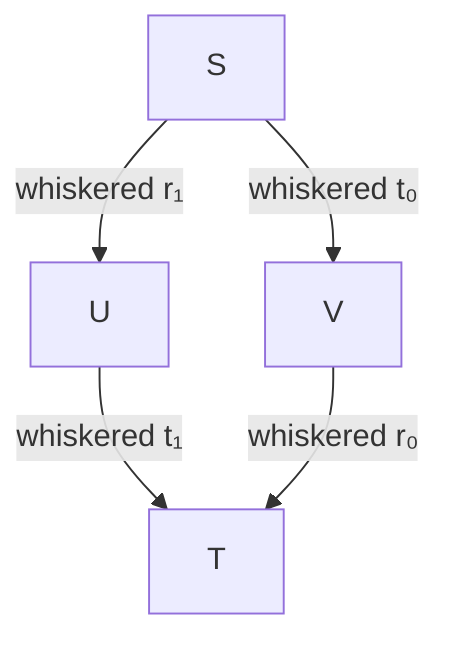

# Free higher categories with directed interchange in every dimension

*A self-contained problem. No background beyond standard higher category theory is assumed.*

## 1. Definitions

**Globular sets and composition.** Work with reflexive globular sets C = (C₀, C₁, …) with source and target maps s, t : C_{n+1} → C_n, identities 1 : C_n → C_{n+1}, and for k < n a partial composition ∗ₖ : C_n ×_{C_k} C_n → C_n, defined when the k-target of the first cell is the k-source of the second. **Composition is written in diagrammatic order**: u ∗ₖ v means "first u, then v". Whiskering a cell by a lower-dimensional cell is composition with an identity. The globular boundary formulas hold: for k < m and (m+1)-cells u, v,

```
s(u ∗ₖ v) = s(u) ∗ₖ s(v),     t(u ∗ₖ v) = t(u) ∗ₖ t(v).        (B)
```

Composition is strictly associative and strictly unital in each dimension.

**The interchange expressions.** For k < l < n and n-cells a, b, c, d arranged so that both sides are defined, put

```
L(a,b,c,d) := (a ∗ₗ b) ∗ₖ (c ∗ₗ d),
R(a,b,c,d) := (a ∗ₖ c) ∗ₗ (b ∗ₖ d).
```

A strict ω-category requires L = R for all such quadruples.

**The known case k = 0 (Gray).** In a category enriched in strict ω-categories with the lax Gray tensor product (Ara–Maltsiniotis, arXiv 1607.00668; Gray-categories in dimension 3), composition along 0-cells does not interchange strictly. For 2-cells α : f ⇒ f′ : x → y and β : g ⇒ g′ : y → z there is a 3-cell

```
χ_{α,β} : (f ◁ β) ∗₁ (α ▷ g′)  ⇛  (α ▷ g) ∗₁ (f′ ◁ β)
```

(f ◁ β is β whiskered by f, α ▷ g is α whiskered by g), and nothing in the reverse direction. Composition along k-cells with k ≥ 1 happens inside the hom ω-categories and interchanges strictly. For higher-dimensional cells, e.g. 3-cells A : α ⇛ α′, the Gray structure does not add a new comparison between raw composites; it asks that χ be natural, i.e. it equates (or, in a weaker setting, compares) the two composites of the square formed by χ_{α,β}, χ_{α′,β} and the whiskerings of A.

**Free objects on pasting diagrams in the Gray case.** Let Γ be a finite globular pasting diagram, written uniquely as a wedge ΣΘ₁ ∨ … ∨ ΣΘₙ of suspensions of smaller pasting diagrams (objects a₀, …, aₙ; Θᵢ is the diagram of cells from aᵢ₋₁ to aᵢ). The free Gray-enriched category on Γ has homs

```
F(Γ)(aᵢ, aⱼ) = ν(λΘᵢ₊₁ ⊗ … ⊗ λΘⱼ),
```

where λΘ is the Steiner complex (augmented directed complex) of Θ, ⊗ is Steiner's tensor of directed complexes, and ν is Steiner's functor to strict ω-categories (Steiner, *Omega-categories and chain complexes*, HHA 2004). So each hom is generated by a finite set of tuples xᵢ₊₁ ⊗ … ⊗ xⱼ of cells of the Θ's, with boundaries given by the Leibniz formula ∂(x ⊗ y) = ∂x ⊗ y + (−1)^{|x|} x ⊗ ∂y, and a cell of the hom is determined by the set of generators it uses (its *support*). The aim is to have the same for directed interchange in **every** dimension.

## 2. What is already known

**(K1) The literal version is impossible.** Suppose that for every n and every k < l < n there is an (n+1)-cell χ : L(a,b,c,d) → R(a,b,c,d), and (B) holds. Then every interchange law holds strictly. *Proof:* apply χ one dimension up to the identities 1_a, 1_b, 1_c, 1_d. Its source and target are parallel, so s(L(1_a,…)) = s(R(1_a,…)), and by (B) and s(1_a) = a this is L(a,b,c,d) = R(a,b,c,d). Concretely: for 2-cells a : f₀ ⇒ f₁, b : f₁ ⇒ f₂ (f's : x → y) and c : g₀ ⇒ g₁, d : g₁ ⇒ g₂ (g's : y → z), raw 4-cells force p := (a ∗₁ b) ∗₀ (c ∗₁ d) to equal q := (a ∗₀ c) ∗₁ (b ∗₀ d), and then 1_p is a reverse 3-cell q → p, contradicting directedness. The same happens with four generating 3-cells in the shape (D³ ∗₁ D³) ∗₀ (D³ ∗₁ D³).

**(K2) The boundary-adjusted comparison is well typed.** For 3-cells A : a ⇛ a′, B : b ⇛ b′, C : c ⇛ c′, D : d ⇛ d′ in the shape just named, let L_A := L(A,B,C,D) : L_a ⇛ L_{a′} and R_A := R(A,B,C,D) : R_a ⇛ R_{a′}, where L_a := L(a,b,c,d) etc., and let χ_a : L_a ⇛ R_a, χ_{a′} : L_{a′} ⇛ R_{a′} be the lower (elementary) interchangers. L_A and R_A are in general not parallel, but

```
L_A ∗₂ χ_{a′}   and   χ_a ∗₂ R_A        are parallel 3-cells  L_a ⇛ R_{a′},        (N)
```

so a directed 4-cell L_A ∗₂ χ_{a′} ⇛ χ_a ∗₂ R_A (or the reverse) is well typed. For identity inputs both sides reduce to χ_a, so (K1)'s argument does not apply. This is the "naturality of the interchanger" pattern of Gray-categories (compare Di Vittorio–Lobbia, arXiv 2310.03503).

**(K3) Supports must use an expanded basis.** If the support of every composite were the union of the supports of its parts, for every composition dimension, then L and R would always have equal support, and "support determines the cell" would force strict interchange. In the Gray case this is avoided because generators are tuples: for adjacent 2-cells α : f₀ ⇒ f₁, β : g₀ ⇒ g₁ the two whiskered paths use {g₀ ⊗ α, β ⊗ f₁} and {β ⊗ f₀, g₁ ⊗ α} respectively.

**(K4) A single finite basis forces finitely many cells.** If one finite set B admits injective maps C_n → 𝒫(B) for every n, then C has only finitely many non-identity cells in total (|C_n| is non-decreasing because identities are injective, and bounded by 2^{|B|}). So if each free object has one finite generating set with injective support, its tower of higher comparisons must terminate.

**(K5) No single directed complex can present the answer.** In ν(K) for any augmented directed complex K, the two composites in the definition of χ_{α,β} have the same table of chains (top chain α + β, 1-chains f + g and f′ + g′), so they are equal. Hence a structure with directed interchange along 0-cells is never ν of one complex; the Gray case escapes by applying ν separately to each hom. The same argument one level down shows that the homs of the desired structure cannot be ν of complexes either, if interchange inside them is to be directed. So a combinatorial description must be iterated: objects, homs presented again by objects and homs, and so on.

**Literature, as far as we know.** No construction meeting requirements 1–5 below, and no impossibility result. Closest: n-sesquicategories, where interchange is absent altogether (Araújo, arXiv 2202.09293, 2210.07704; Forest–Mimram, arXiv 2211.16099, and *Rewriting in Gray categories*, MSCS 2022); Crans's teisi and Bourke–Lobbia, *Semi-strict 4-categories as enriched categories* (arXiv 2610.31448), whose §4.2.6 "lax 4-categories" have non-invertible 3-cell interchangers and some non-invertible 4-cell comparisons but keep invertible interchange inside homs, and which are monadic over 4-globular sets (§4.3), so they give free objects abstractly in dimension 4 but no support description; Bourke–Gurski's cocategorical obstruction to tensor products of Gray-categories, which needs hypotheses (cocontinuous biclosed tensor) not assumed here.

## 3. The question

Call a structure of the following kind a **lax-interchange ω-category**: a reflexive globular set with strictly associative and unital compositions ∗ₖ satisfying (B), together with, for every k < l,

- *elementary interchangers*: for (l+1)-cells a, b, c, d in interchange position, an (l+2)-cell χ : L(a,b,c,d) ⇛ R(a,b,c,d), with no cell in the reverse direction in free objects;
- *boundary-adjusted higher comparisons*: for cells of dimension n > l + 1 in interchange position, an (n+1)-cell between composites of the form (N), i.e. with the lower interchangers composed onto the raw expressions so that source and target are parallel; never a raw cell L → R;
- coherence equations among all of these (with each other and with further composition), to be determined.

**Requirements on free objects.** For each finite globular pasting diagram Γ, write F(Γ) for the free lax-interchange ω-category on Γ.

1. **Combinatorial description.** F(Γ) has an explicit description by a graded set of generators (expected: iterated tuples of cells of Γ, one tuple-level for each pair k < l involved) with explicit boundaries, from which cells can be computed mechanically.
2. **Support determines cells.** Two cells of F(Γ) of the same dimension that use the same set of generators (in the expanded basis of (K3)) are equal.
3. **Directedness.** For every k < l the elementary interchanger between two cells of Γ side by side along a k-cell exists in F(Γ), and no cell exists in the reverse direction.
4. **Comparison.** Making every interchanger with k ≥ 1 an identity gives the free Gray-enriched category of §1; making all of them identities gives the free strict ω-category on Γ.
5. **Substitution.** For a pasting diagram Γ′ and an assignment of cells of F(Γ) to the generators of Γ′ with matching boundaries, there is an induced structure map F(Γ′) → F(Γ). (Equivalently the F(Γ) form a globular-operad-like family.)

**Questions.**

**Q1 (main).** Is there a choice of boundary-adjusted higher comparisons and coherence equations for which free objects F(Γ) satisfy requirements 1–5? A complete answer is either a definition with a combinatorial description of F(Γ) meeting 1–5 (even only up to some finite dimension N, with N ≥ 5), or a proof that requirements 1–3 cannot hold together for any such choice.

**Q2 (first non-trivial case).** Take Γ = ΣD² ∨ ΣD²: two 3-cells A : α ⇛ α′ (α, α′ : f ⇒ f′ : x → y) and B : β ⇛ β′ (β, β′ : g ⇒ g′ : y → z) side by side along the 0-cell y. In the Gray case the hom from x to z is ν(λD² ⊗ λD²), with a 4-dimensional top generator. Inside that hom there are cells side by side along hom-0-cells (for instance the whiskered faces of the top generator), whose interchange the Gray case makes strict and the present structure must direct. Write down the generators of F(Γ) up to dimension 5 forced by this, with their boundaries, and check requirement 2 for them. Does the outcome agree with Bourke–Lobbia's lax 4-categories after truncation?

**Q3 (finiteness).** By (K4), the finite-basis version of requirement 1 needs each F(Γ) to have finitely many non-identity cells. Is there a finite Γ for which the boundary-adjusted comparisons and their coherences force infinitely many non-identity cells? A yes refutes the finite-basis version; then the question becomes whether F(Γ) can be described with a basis that is finite in each dimension.

**Q4 (orientation).** In (N), is the orientation L_A ∗₂ χ_{a′} ⇛ χ_a ∗₂ R_A forced, given the elementary interchanger's direction and requirement 3, or are both orientations consistent? If both are, do the two choices give equivalent theories?

**Hints that may help.** Generators as tuples with a Leibniz rule in which "∂ of a factor" is itself a cell of a smaller free object rather than a chain (making this precise needs a tensor of a *composite* with a generator, which is where the chain-complex calculus stops). Hadzihasanovic's regular directed complexes and molecules (arXiv 2404.07273) and Chanavat's Gray products of diagrammatic sets (arXiv 2505.01387) handle pasting without fixing an interchange law and may supply the generator sets. Araújo's n-sesquicategorical computads with an interchange generator added for each pair k < l, as in Forest–Mimram's Gray presentations, are a natural ambient for Q2.

# Researcher Response

**The mandatory joint comparison (N) is incompatible with the Gray comparison and substitution requirements. Your example in Q2 already gives a counterexample: in its prescribed Gray quotient, neither orientation of (N) has a 4-cell.**

This is a different obstruction from K1. The two boundary-adjusted 3-cells are parallel. What fails is the existence of a directed comparison between them.

Consequently, no choice of additional coherence equations can satisfy all five requirements **while retaining a comparison for every joint instance of (N)**. This does not prove impossibility of requirements 1–3 alone, or of a formulation using different higher comparison boundaries.

## 1. The calculation in \(\nu(D^2\otimes D^2)\)

Write

\[
\alpha_0=\alpha,\quad \alpha_1=\alpha',
\qquad
\beta_0=\beta,\quad \beta_1=\beta',
\]

and similarly \(f_0=f,f_1=f'\), \(g_0=g,g_1=g'\).

Let

\[
K=\lambda D^2\otimes\lambda D^2,
\qquad H=\nu K.
\]

Throughout the calculation, **hom dimension \(n\) means global dimension \(n+1\)**. Write \(\circ_k\) for composition indexed by hom dimensions, still in diagrammatic order. Thus \(\circ_k\) corresponds to global \(\ast_{k+1}\).

### The complete tensor basis

The following are the 25 basis elements of the prescribed **Gray quotient**. They are not being proposed as generators for the nonexistent \(F(\Gamma)\).

| Hom dimension | Global dimension | Basis elements | Number |
|---:|---:|---|---:|
| \(0\) | \(1\) | \(e_{ij}=f_i\otimes g_j\) | \(4\) |
| \(1\) | \(2\) | \(a_{ij}=\alpha_i\otimes g_j,\quad b_{ij}=f_i\otimes\beta_j\) | \(8\) |
| \(2\) | \(3\) | \(u_j=A\otimes g_j,\quad v_i=f_i\otimes B,\quad c_{ij}=\alpha_i\otimes\beta_j\) | \(8\) |
| \(3\) | \(4\) | \(r_j=A\otimes\beta_j,\quad t_i=\alpha_i\otimes B\) | \(4\) |
| \(4\) | \(5\) | \(w=A\otimes B\) | \(1\) |

All indices range over \(\{0,1\}\).

The lower boundaries are

\[
a_{ij}:e_{0j}\longrightarrow e_{1j},
\qquad
b_{ij}:e_{i0}\longrightarrow e_{i1},
\]

\[
u_j:a_{0j}\Rightarrow a_{1j},
\qquad
v_i:b_{i0}\Rightarrow b_{i1}.
\]

Define the paths

\[
P_{ij}=b_{0j}\circ_0a_{i1},
\qquad
Q_{ij}=a_{i0}\circ_0b_{1j}.
\]

Here \(P\) performs the \(\beta\)-step first, while \(Q\) performs the \(\alpha\)-step first. The elementary tensor atom has the stipulated orientation

\[
c_{ij}:P_{ij}\Rightarrow Q_{ij}.
\]

The Leibniz rule gives

\[
\begin{aligned}
\partial u_j&=a_{1j}-a_{0j},\\
\partial v_i&=b_{i1}-b_{i0},\\
\partial c_{ij}&=a_{i0}+b_{1j}-b_{0j}-a_{i1},
\end{aligned}
\tag{1}
\]

and, crucially,

\[
\boxed{
\begin{aligned}
\partial r_j&=c_{1j}+u_1-c_{0j}-u_0,\\
\partial t_i&=c_{i0}+v_1-c_{i1}-v_0.
\end{aligned}}
\tag{2}
\]

Finally,

\[
\partial w=r_1+t_1-r_0-t_0.
\tag{3}
\]

These are direct calculations from the tensor differential in the question.

### The necessary positivity condition

For a hom 3-cell \(Z:X\Rightarrow Y\) in \(\nu K\), its top chain \(z\in K_3\) must have nonnegative coefficients and satisfy

\[
\partial z=[Y]_2-[X]_2.
\tag{4}
\]

Here \([X]_2\) denotes the degree-2 chain coordinate of \(X\). Top chain coordinates add under lower-dimensional composition. These facts follow directly from Steiner’s definitions of \(\mu K\), \(\nu K\), and their composition operations. Only this necessary condition for existence will be used. [arxiv.org](https://arxiv.org/pdf/math/0403237?utm_source=chatgpt.com)

## 2. Two parallel 3-cells with no 4-cell in either direction

Consider the following hom 2-cells:

\[
\boxed{
U=(v_0\circ_0u_1)\circ_1c_{11},
\qquad
V=c_{00}\circ_1(u_0\circ_0v_1).
}
\tag{5}
\]

Both have source \(P_{00}\) and target \(Q_{11}\). Thus they are genuinely parallel **global 3-cells**.

Their top chain coordinates are

\[
[U]_2=v_0+u_1+c_{11},
\qquad
[V]_2=c_{00}+u_0+v_1.
\tag{6}
\]

Every nonnegative degree-3 chain of \(K\) has the form

\[
z=\lambda_0r_0+\lambda_1r_1+\mu_0t_0+\mu_1t_1,
\qquad
\lambda_i,\mu_i\in\mathbb N.
\]

Equation (2) implies

\[
\operatorname{coeff}_{u_0}(\partial z)
=-(\lambda_0+\lambda_1)\leq 0,
\tag{7}
\]

\[
\operatorname{coeff}_{v_0}(\partial z)
=-(\mu_0+\mu_1)\leq 0.
\tag{8}
\]

Now suppose there were a global 4-cell \(U\Rightarrow V\). Its hom-degree-3 chain would have to satisfy

\[
\partial z=[V]_2-[U]_2.
\]

But the right-hand side has coefficient \(+1\) at \(u_0\), contradicting (7).

Conversely, a global 4-cell \(V\Rightarrow U\) would require

\[
\partial z=[U]_2-[V]_2,
\]

whose coefficient at \(v_0\) is \(+1\), contradicting (8).

Therefore

\[
\boxed{
\text{There is no global 4-cell }U\Rightarrow V
\text{ and no global 4-cell }V\Rightarrow U.
}
\tag{9}
\]

This excludes every candidate cell, including composites and whiskerings. It is not merely an observation that no basis generator has the desired boundary.

The hom-degree-4 atom \(w=A\otimes B\) cannot change this conclusion: every hom 3-cell still must satisfy (4) with a nonnegative degree-3 chain.

## 3. Why these are forced images of your joint comparison

The remaining point is to establish that (5) really is the image of an instance of (N), independently of a discretionary choice of binary horizontal composition.

### 3.1 Elementary unit instances fix the horizontal product

First work with two global 2-globes, with generators

\[
\alpha:f_0\Rightarrow f_1,
\qquad
\beta:g_0\Rightarrow g_1.
\]

Write \(h=\alpha\ast_0\beta\).

Your elementary schema is

\[
(a\ast_1b)\ast_0(c\ast_1d)
\longrightarrow
(a\ast_0c)\ast_1(b\ast_0d).
\]

The two substitutions

\[
(a,b,c,d)
=(\alpha,1_{f_1},1_{g_0},\beta)
\]

and

\[
(a,b,c,d)
=(1_{f_0},\alpha,\beta,1_{g_1})
\]

give, respectively,

\[
h\longrightarrow Q,
\qquad
h\longrightarrow P.
\tag{10}
\]

In the Gray hom \(\nu(\lambda D^1\otimes\lambda D^1)\), the relevant paths are exactly \(P,Q\), with the unique nonidentity comparison \(c:P\Rightarrow Q\). There is no comparison \(Q\Rightarrow P\). Hence (10) forces

\[
h=P,
\]

and the first elementary interchanger is \(c:P\Rightarrow Q\).

To transfer this to each \((i,j)\)-face of the two-3-cell example, use requirement 5. Assign the two generating 2-cells of

\[
\Sigma D^1\vee\Sigma D^1
\]

to \(\alpha_i,\beta_j\). The resulting structure map descends through the quotient of requirement 4, because it preserves the named interchangers and therefore preserves the equations making the \(k\geq1\) interchangers identities. As a map of free Gray-enriched categories on the specified generators, it is the canonical face inclusion.

Consequently,

\[
\alpha_i\ast_0\beta_j=P_{ij},
\tag{11}
\]

and

\[
\chi(\alpha_i,1_{f_1},1_{g_0},\beta_j)=c_{ij}
\tag{12}
\]

in the prescribed quotient.

This face argument is necessary: the full \(D^2\otimes D^2\) hom has all eight paths \(P_{ij},Q_{ij}\), with the same endpoints. The conclusion does not follow merely by counting paths in the full hom.

### 3.2 The higher horizontal product is fixed as well

By (B) and (11), the image of \(A\ast_0B\) must have boundary

\[
P_{00}\Rightarrow P_{11}.
\tag{13}
\]

Its nonnegative degree-2 chain has the form

\[
z=x_0u_0+x_1u_1+y_0v_0+y_1v_1
  +\sum_{i,j}z_{ij}c_{ij}.
\]

Define a linear functional \(q:K_1\to\mathbb Z\) by

\[
q(a_{i0})=1,
\]

and assign value zero to every other degree-1 basis element. Equation (1) gives

\[
q(\partial u_j)=q(\partial v_i)=0,
\qquad
q(\partial c_{ij})=1.
\]

But

\[
q([P_{11}]_1-[P_{00}]_1)=0.
\]

Thus \(\sum z_{ij}=0\), so every \(z_{ij}=0\). Comparing the remaining coefficients in

\[
\partial z
=b_{01}+a_{11}-b_{00}-a_{01}
\]

then gives

\[
x_0=y_1=0,\qquad x_1=y_0=1.
\]

Therefore

\[
[A\ast_0B]_2=v_0+u_1.
\tag{14}
\]

With its boundaries fixed, this is the hom 2-cell \(v_0\circ_0u_1\): the lower chain coordinates are fixed by those boundaries.

### 3.3 Apply (N)

Use the exact higher quadruple

\[
\boxed{
(A,\ 1_{1_{f_1}},\ 1_{1_{g_0}},\ B).
}
\tag{15}
\]

Its lower source quadruple is

\[
(\alpha_0,1_{f_1},1_{g_0},\beta_0),
\]

and its lower target quadruple is

\[
(\alpha_1,1_{f_1},1_{g_0},\beta_1).
\]

In the Gray quotient,

\[
L_A=A\ast_0B=v_0\circ_0u_1,
\]

\[
R_A=u_0\circ_0v_1,
\]

and the two lower interchangers are \(c_{00},c_{11}\).

Consequently, the two sides of (N) map to exactly

\[
L_A\ast_2\chi_{a'}
\longmapsto U,
\qquad
\chi_a\ast_2R_A
\longmapsto V.
\]

Whichever direction is selected for this instance of (N), its image would contradict (9).

Declaring that comparison to become an identity in the quotient does not help: it would force \(U=V\), whereas their degree-2 chain coordinates in (6) differ.

**This proves incompatibility of mandatory joint (N) with requirements 4–5.** It is independent of support, finiteness, and any additional coherence equations.

## 4. Q4: the two variables require opposite naturality directions

The one-variable cases explain why the joint comparison fails.

The actual boundaries of the four global 4-dimensional tensor atoms are

\[
\boxed{
r_j:
c_{0j}\circ_1(u_0\circ_0 1_{b_{1j}})
\;\Longrightarrow\;
(1_{b_{0j}}\circ_0u_1)\circ_1c_{1j},
}
\tag{16}
\]

and

\[
\boxed{
t_i:
(v_0\circ_0 1_{a_{i1}})\circ_1c_{i1}
\;\Longrightarrow\;
c_{i0}\circ_1(1_{a_{i0}}\circ_0v_1).
}
\tag{17}
\]

Their directions follow from the two differentials in (2).

Relative to the notation \(U=L_A\ast_2\chi_{a'}\) and \(V=\chi_a\ast_2R_A\), this gives:

| Higher variation | Tensor atom | Required Gray direction |
|---|---|---|
| Only \(A:\alpha\Rightarrow\alpha'\) varies | \(A\otimes\beta\) | \(V\Rightarrow U\) |
| Only \(B:\beta\Rightarrow\beta'\) varies | \(\alpha\otimes B\) | \(U\Rightarrow V\) |

Each smaller tensor, \(D^2\otimes D^1\) or \(D^1\otimes D^2\), has a single degree-3 basis element. The reverse direction would require its negative, so these directions are forced by the Gray specialization.

Thus:

- The uniform orientation displayed in (N) fails the first row.
- Its uniform reverse fails the second row.
- Choosing the direction separately for each input still fails the simultaneous instance (15), because neither direction exists there.

These conclusions use the Gray comparison requirement; they are not deductions from elementary directedness alone. Under the complete requirements, there are not two consistent choices whose equivalence remains to be decided.

## 5. Q2: what the global 5-cell actually compares

The top atom \(w=A\otimes B\) compares two **routes of global 4-cells**. It does not supply a global 4-cell between \(U\) and \(V\).

To display its boundary explicitly, define two more hom 2-cells:

\[
S=
(v_0\circ_0 1_{a_{01}})
\circ_1c_{01}
\circ_1(u_0\circ_0 1_{b_{11}}),
\]

\[
T=
(1_{b_{00}}\circ_0u_1)
\circ_1c_{10}
\circ_1(1_{a_{10}}\circ_0v_1).
\]

Like \(U,V\), both have source \(P_{00}\) and target \(Q_{11}\). Their top chains are

\[
[S]_2=v_0+c_{01}+u_0,
\qquad
[T]_2=u_1+c_{10}+v_1.
\]

Appropriately whiskered instances of (16)–(17) form the following diagram. Its vertices are global 3-cells and its arrows are global 4-cells.



The global 5-cell \(w\) is directed

\[
\boxed{
(S\xrightarrow{\,t_0\,}V\xrightarrow{\,r_0\,}T)
\;\Longrightarrow\;
(S\xrightarrow{\,r_1\,}U\xrightarrow{\,t_1\,}T),
}
\tag{18}
\]

where the labels denote those whiskered instances. Equation (3) gives precisely this orientation.

For completeness, its entire Steiner table is:

| Hom degree | Negative coordinate | Positive coordinate |
|---:|---|---|
| \(4\) | \(w\) | \(w\) |
| \(3\) | \(t_0+r_0\) | \(r_1+t_1\) |
| \(2\) | \(v_0+c_{01}+u_0\) | \(u_1+c_{10}+v_1\) |
| \(1\) | \(b_{00}+a_{01}\) | \(a_{10}+b_{11}\) |
| \(0\) | \(e_{00}\) | \(e_{11}\) |

The intermediate vertices \(U,V\) of this directed diagram are incomparable. That is exactly what the coefficient proof established.

### Support

The obstruction respects the expanded basis. In particular,

\[
\operatorname{supp}_2(U)=\{v_0,u_1,c_{11}\},
\qquad
\operatorname{supp}_2(V)=\{c_{00},u_0,v_1\}.
\]

These are different sets of tensor generators. No identification of \(u_0\) with \(u_1\), or of \(v_0\) with \(v_1\), has been made.

The table for \(w\) also has coefficients in \(\{0,1\}\), with disjoint negative and positive supports below its top dimension. Thus this calculation does not exhibit a failure of the Gray support criterion. It exhibits the absence of the demanded comparison.

There is therefore no list of generators for an \(F(\Gamma)\) satisfying the stated requirements to check through dimension 5: the contradiction already occurs in dimension 4.

### Comparison with Bourke–Lobbia

There is no resulting \(F(\Gamma)\) to truncate under these axioms. Independently, Bourke–Lobbia’s lax 4-categories retain ordinary Gray-categories as homs. Their local interchangers—global 4-cells—are invertible, although the designated global 3-cell interchangers and some other global 4-cell comparisons need not be. This differs from the nontrivial one-way local interchangers demanded in Q2. [arxiv.org](https://arxiv.org/html/2610.31448v2?utm_source=chatgpt.com)

## 6. Scope for Q1 and Q3

**Q1, with a compulsory comparison for every joint instance of (N): negative.** The simultaneous variation of the two generating 3-cells in \(\Sigma D^2\vee\Sigma D^2\) has no possible image in the required Gray quotient. Allowing more generators, either finitely or infinitely many, cannot supply that missing image.

This is a negative answer using requirements 4–5. It does **not** establish the stronger claim that requirements 1–3 alone are incompatible for every possible coherence theory.

**Q3 is not settled for a further revised theory.** No finite diagram forcing an infinite tower of nonidentity cells has been established here. The current formulation fails at dimension 4, so its failure is not a finiteness obstruction.

The necessary correction is more specific than adjusting boundaries to make them parallel: higher comparison shapes must respect the opposite naturality directions in (16) and (17). The simultaneous interaction is represented in the Gray quotient by the global 5-cell (18), comparing two routes of global 4-cells, rather than by either global 4-cell proposed in (N).
